# 六扇門（Six-Gate for Vibe Code）

> 本文件中英對照：每一節先正體中文、後 English。
> This document is bilingual: each section is written in Traditional Chinese first, then in English.

把 Vibe Coding 的資安測試整理成「G0 威脅建模 + G1–G6 六道閘門」的互動教學工具，對齊 OWASP ASVS 5.0.0。設計期、白箱、黑箱與 AI 紅隊各有一道關卡，Harness 把它們串成一次放行裁決。介面提供正體中文與英文切換（預設中文）。

An interactive teaching tool that organizes security testing for vibe coding into "G0 threat modeling + six gates G1–G6", aligned with OWASP ASVS 5.0.0. Design-time, white-box, black-box and AI red-team each get a gate, and the Harness chains them into one release verdict. The UI switches between Traditional Chinese and English (Chinese by default).

> Harness 是**示範模擬**：發現項與證據是依你選的情境產生的教學範例，不會掃描任何真實系統。章節對照是教學摘要，正式驗證以標準原文為準。
>
> The Harness is a **demo simulation**: findings and evidence are teaching examples generated from the scenario you pick; nothing real is scanned. Chapter references are a teaching summary; verify against the standard itself.

## GitHub Pages 部署 / GitHub Pages deployment

GitHub Pages 是建議的部署方式。將變更合併至 `main` 後，GitHub Actions 的 **Deploy GitHub Pages** 工作流程會建置並測試靜態網站，再部署至 Pages；首次使用請在 repository 的 **Settings → Pages → Build and deployment → Source** 選擇 **GitHub Actions**。專案網址通常是 `https://<owner>.github.io/<repository>/`。工作流程依 repository 名稱設定網址前綴，使用者或組織的 `<owner>.github.io` repository 則使用根路徑。

GitHub Pages is the recommended deployment. On pushes to `main`, **Deploy GitHub Pages** builds and tests the static site before deployment. Set **Settings → Pages → Build and deployment → Source** to **GitHub Actions** once. The usual URL is `https://<owner>.github.io/<repository>/`; user or organization `<owner>.github.io` repositories use the root path.

靜態版的情境、清單、語系、結果與下載功能都在瀏覽器運作。GitHub Pages 不提供伺服器端 CSP 回報 API 或 Vercel 的自訂 HTTP 安全標頭，也不提供伺服器產生的 PWA 安裝教學；若需要這些功能，仍可選用下文描述的伺服器版本。下方架構圖與安全標頭章節描述的是該伺服器版本，不適用於 GitHub Pages。

Scenarios, checklists, language, results and downloads run in the browser on the static site. GitHub Pages does not provide the server-side CSP reporting endpoint, Vercel custom HTTP security headers or the server-generated PWA installation tutorial. The server build remains available if those features are needed; the architecture diagram and security-header section below describe that build, not GitHub Pages.

靜態版的頁首（標題、描述、theme-color、主題開機腳本）與伺服器版共用 `src/document-head.ts`，由 `vite.pages.config.ts` 的外掛在建置時注入；首頁的路由選項讀 `src/routes/index.tsx`，路由器預設值跟伺服器版共用 `src/app-route.ts`。

The static site's head (title, description, theme-color, theme bootstrap) shares `src/document-head.ts` with the server build and is injected at build time by a plugin in `vite.pages.config.ts`; the index route's options come from `src/routes/index.tsx`, and the router defaults are shared through `src/app-route.ts`.

本機可用 `npm run build:pages` 建置，以及 `npm run test:pages` 測試已建置的靜態網站；`npm run test:pages:throttled` 會把 CPU 降速 10 倍再測一次，CI 兩種都會跑。測試需要 Playwright Chromium。若需模擬專案子路徑，建置和測試時將 `GITHUB_REPOSITORY` 設為 `owner/repository`。

Run `npm run build:pages` and `npm run test:pages` locally to build and test the static site; `npm run test:pages:throttled` tests it again with the CPU slowed tenfold, and CI runs both. The tests require Playwright Chromium. Set `GITHUB_REPOSITORY` to `owner/repository` for both commands to simulate a project subpath.

## 使用方式 / Getting started

1. 從首頁進入管線，先選擇預設情境，再調整受測系統條件。管線畫面內的三步引導可直接跳到設定、執行按鈕與結果。
2. 執行模擬驗證後，先處理阻擋項；展開發現可查看原因、影響、示範證據、修正方式與重新驗證條件。
3. 修正設定後重新執行，再下載放行紀錄。勾選閘門控制項只會更新「管線缺口」，不會把示範發現改成通過。有條件放行的警示仍需負責人與期限。

4. Open the pipeline from the overview, choose a preset and adjust the system settings. The three-step guide in the Pipeline view links directly to settings, the run control and results.
5. Run the simulation and address blocking findings first. Expand a finding for its cause, impact, demo evidence, remediation and retest criteria.
6. Update the settings, run again and download the release record. Gate checks update the pipeline gaps only; they never change a finding to a pass. Conditional-release advisories still need an owner and deadline.

鍵盤換頁後焦點會移到主標題，完成驗證後移到結果區；手機上的七個閘門選項會換行顯示。頁尾提供法規觀測與每日威脅情報的相關網站連結。

Navigation moves keyboard focus to the page heading; completing a run moves it to the results. All seven gate options wrap on narrow screens. Related regulatory and daily threat-intelligence sites are linked from the footer.

## 🏛️ 系統架構與流程 / Architecture Overview

整個 App 在瀏覽器裡執行：伺服器端只負責 SSR、平台的 PWA 中介層與一個收 CSP 違規回報的端點（`/api/csp-report`），沒有模型呼叫，也不掃描任何真實系統。下圖由上而下是一次請求經過的五層，每一層一排；灰色是平台元件，米色是資料與輸出。同一排裡的卡片沒有先後關係（部署層以數字標示順序）。

The app runs in the browser: the server side only does SSR, the platform's PWA middleware and one endpoint that collects CSP violation reports (`/api/csp-report`). There is no model call and no real scanning. Top to bottom, the diagram shows the five layers a request passes through, one row per layer; grey boxes are platform components, beige boxes are data and output. Cards in the same row have no ordering (the deploy row is numbered).

```mermaid
flowchart TB
    USER(["使用者瀏覽器<br/>User browser"])

    subgraph DEPLOY["① 部署 Deploy（Vercel）"]
        HDR["1 安全標頭 Security headers<br/>security-headers.mjs<br/>只在正式建置 production only"]
        NITRO["2 Nitro SSR<br/>vite build<br/>vercel preset"]
        PWA["3 平台中介層 Platform middleware<br/>server/middleware/grok-pwa.ts<br/>PWA・OG・manifest"]
    end

    subgraph ROUTE["② 路由 Routing"]
        ROUTER["src/router.tsx<br/>getRouter()<br/>錯誤・找不到<br/>error・not-found"]
        ROOT["src/routes/__root.tsx<br/>head（brand.ts）<br/>PreviewHostBridge"]
        INDEX["src/routes/index.tsx<br/>parseSearch<br/>view・gate・lang<br/>對照頁 map：tab・filter・q"]
        CSPR["src/routes/api/csp-report.ts<br/>CSP 違規回報 violation reports<br/>一請求一行日誌 one log line"]
    end

    subgraph STATE["③ 狀態 State（只在瀏覽器 browser only）"]
        URLS[("網址 URL<br/>view・gate・lang<br/>tab・filter・q")]
        APP["AppStateProvider<br/>app-state.tsx"]
        STORE[("localStorage<br/>storage.ts<br/>six-gate-profile<br/>six-gate-checks<br/>six-gate-locale<br/>six-gate-theme（淺色／深色 light／dark）<br/>舊鍵自動搬移 migrated")]
        RUNS[("sessionStorage<br/>six-gate-run<br/>最近一次執行 latest run")]
        HRUN["harness-run.ts<br/>執行・逐道揭示・停止・過期<br/>run・reveal・stop・stale"]
        LOC["LocaleProvider<br/>useT()<br/>src/i18n/context.tsx"]
    end

    subgraph UI["④ 介面 UI（src/components）"]
        SHELL["AppShell<br/>shell.tsx<br/>導覽・語言與主題切換<br/>nav・language・theme"]
        VIEWS["六個畫面<br/>Six views<br/>總覽・管線・閘門<br/>分級・對照・工具"]
        FORM["ProfileForm<br/>受測系統設定<br/>system under test"]
    end

    subgraph RULES["⑤ 規則 Rules（純函式 pure functions）"]
        BI["src/i18n/locale.ts<br/>Bi＝{ zh, en }<br/>bi()・pick()・joinList()"]
        MODEL["src/data/model.ts<br/>閘門・控制項・ASVS・預設情境<br/>gates・controls・presets<br/>全部 Bi all bilingual"]
        ENGINE["src/data/engine.ts<br/>示範模擬 demo simulation<br/>recommendLevel → buildPlan<br/>→ 裁決 verdict"]
        CATALOGUE["src/data/finding-catalogue.ts<br/>發現目錄 finding catalogue<br/>FindingId・文案 text・縱深項 depth items"]
        GAPS["src/data/pipeline-gaps.ts<br/>攔截條件 catch requirements<br/>catchStatus → 管線缺口 pipeline gaps"]
    end

    OUT[/"放行紀錄 Release record<br/>six-gate-release-YYYY-MM-DD.md<br/>中文或英文 zh／en"/]

    USER -- "HTTPS" --> DEPLOY
    DEPLOY -- "HTML＋JS" --> ROUTE
    ROUTE -- "view・gate・lang" --> STATE
    STATE -- "profile・checks・harness・locale" --> UI
    UI -- "執行 Harness Run：buildPlan(profile)" --> RULES
    RULES -- "reportMarkdown(…, locale)" --> OUT

    classDef platform fill:#eef0f2,stroke:#8a949c,color:#333
    classDef store fill:#fff6e0,stroke:#c9a14a,color:#333
    class HDR,NITRO,PWA platform
    class URLS,STORE,RUNS,OUT store
```



**流程 / Flow**

1. **部署 Deploy**：Vercel 回應前先套用安全標頭（只在正式建置），Nitro 做 SSR，平台中介層注入 PWA 與分享卡片標記。
   Vercel applies the security headers (production builds only), Nitro renders server-side, and the platform middleware injects PWA and share-card tags.
2. **路由 Routing**：`getRouter()` 掛上錯誤與找不到畫面；`__root.tsx` 輸出 head 與 `PreviewHostBridge`；`index.tsx` 以 `parseSearch` 只留下合法的 `view`、`gate`、`lang` 與對照頁的 `tab`、`filter`、`q`；`api/csp-report.ts` 收瀏覽器送來的 CSP 違規回報。
   `getRouter()` wires the error and not-found screens; `__root.tsx` renders the head and `PreviewHostBridge`; `index.tsx` keeps only valid `view`, `gate`, `lang` and the map's `tab`, `filter` and `q` via `parseSearch`; `api/csp-report.ts` receives the browser's CSP violation reports.
3. **狀態 State**：`AppStateProvider` 讀寫網址參數，經 `storage.ts` 安全讀寫 localStorage（含舊 `vibegate-*` 鍵搬移），並決定語系交給 `LocaleProvider`。Harness 的執行、逐道揭示、停止、過期與 sessionStorage 存檔都在 `harness-run.ts`，畫面透過 `useApp().harness` 取用。
   `AppStateProvider` reads and writes the URL params, persists to localStorage (including the `vibegate-*` migration) through `storage.ts`, and hands the locale to `LocaleProvider`. The Harness run, its reveal, Stop, staleness and the sessionStorage record live in `harness-run.ts`; views read them through `useApp().harness`.
4. **介面 UI**：`AppShell` 提供導覽、中文／EN 切換與淺色／深色主題切換；在「管線」畫面按下執行 Harness，`ProfileForm` 的設定交回狀態層。
   `AppShell` provides navigation, the 中文 / EN switch and the light / dark theme toggle; pressing Run on the Pipeline view sends the `ProfileForm` settings back to state.
5. **規則 Rules**：`engine.ts` 以純函式 `recommendLevel → buildPlan` 產生七道閘門的結果與裁決，只決定出現哪些發現與嚴重度，發現的文案、影響與重新驗證條件都在發現目錄 `finding-catalogue.ts`；`pipeline-gaps.ts` 的 `catchStatus` 依各發現的攔截條件對照閘門頁勾選，算出管線缺口；內容全部來自 `model.ts` 的雙語 `Bi`。
   `engine.ts` runs the pure `recommendLevel → buildPlan` to produce the seven gate results and the verdict, deciding only which findings appear and how severe; each finding's text, impact and retest criteria live in the finding catalogue `finding-catalogue.ts`; `catchStatus` in `pipeline-gaps.ts` checks each finding's catch requirement against the gates-page checks to find pipeline gaps; all content is bilingual `Bi` from `model.ts`.
6. **輸出 Output**：`reportMarkdown(…, locale)` 依目前語系產生 `six-gate-release-YYYY-MM-DD.md` 供下載；日期與時間用使用者所在時區，設定在執行後改過時會加註。
   `reportMarkdown(…, locale)` writes `six-gate-release-YYYY-MM-DD.md` in the current locale for download; the date and time are in the viewer's time zone, and a note is added when the settings changed after the run.

> Harness 的發現項與證據是依情境產生的教學範例，實際放行要接你們自己的 SAST、SCA、DAST 與紅隊結果。
>
> Harness findings and evidence are teaching examples; a real release plugs in your own SAST, SCA, DAST and red-team results.

## 畫面 / Views

| 畫面 View     | 內容 Content                                                                                                                                                                                                                                                                    |
| ------------- | ------------------------------------------------------------------------------------------------------------------------------------------------------------------------------------------------------------------------------------------------------------------------------- |
| 總覽 Overview | 會被 AI 生成速度放大的缺陷、事故對到閘門、ASVS 5.0 等級比例，以及資料來源清單（同時列在下載的放行紀錄）<br/>Defects that generation speed amplifies, incidents mapped to gates, ASVS 5.0 level shares, and the list of sources (also appended to the downloaded release record) |
| 管線 Pipeline | 設定受測系統，執行 Harness，看各閘門裁決、放行紀錄與「你們的管線缺口」<br/>Configure the system under test, run the Harness, see each gate's verdict, the release record and "your pipeline gaps"                                                                               |
| 閘門 Gates    | G0–G6 的時機、對抗對象與控制項清單；勾選代表你們真實的管線已有該控制<br/>When each of G0–G6 runs, what it defends against, its control checklist; a check means your real pipeline has that control                                                                             |
| 分級 Levels   | L1／L2／L3 的意義、建議等級與在 Harness 裡的效果<br/>What L1 / L2 / L3 mean, the recommended level and its effect in the Harness                                                                                                                                                |
| 對照 Map      | 白箱與黑箱的雙向對照，以及 ASVS 十七章<br/>The two-way white-box / black-box map and the seventeen ASVS chapters                                                                                                                                                                |
| 工具 Tools    | SAST、SCA、DAST、AI 紅隊工具的定位與限制<br/>Where SAST, SCA, DAST and AI red-team tools fit, and their limits                                                                                                                                                                  |

畫面、閘門與語系寫在網址裡（例如 `?view=gates&gate=G3&lang=en`），對照頁的分頁、閘門篩選與搜尋字也是（例如 `?view=map&tab=chapters&filter=G5&q=授權`），都可以直接分享；明確選擇語系後會保留在網址；其他預設值不會出現在網址。受測系統設定、勾選、語系與主題（鍵 `six-gate-theme`，`light` 或 `dark`，不寫進網址）只存在瀏覽器的 localStorage，舊版 `vibegate-*` 鍵會在第一次載入時自動搬到 `six-gate-*`。最近一次 Harness 結果與規則版本存在 sessionStorage（`harness-run.ts`）：版本不同時需重新執行；重新整理還在，關掉分頁就清掉。裁決在按下執行時就已確定，閘門逐道揭示時按「停止」會還原成上一次的結果；揭示中離開管線頁等於看完，回來時直接全部顯示。只改系統名稱、改了又改回來，或切換沙箱、出向 Allow-list 這類不改變裁決的設計期緩解，都不會被當成「設定已改」（判斷方式是用目前的設定重新跑一次規則，結果相同就不算）；設定改過時，管線頁與閘門頁都會標出裁決已過期。

View, gate and locale live in the URL (for example `?view=gates&gate=G3&lang=en`), and so do the map's tab, gate filter and query (for example `?view=map&tab=chapters&filter=G5&q=authorization`), so links can be shared; an explicitly selected locale stays in the URL; other defaults stay out. The system settings, checks, locale and theme (key `six-gate-theme`, `light` or `dark`, never in the URL) are stored only in the browser's localStorage; the old `vibegate-*` keys are migrated to `six-gate-*` on first load. The latest Harness run and rule version live in sessionStorage (`harness-run.ts`): a version mismatch requires a new run; it survives a reload and is gone when the tab closes. The verdict is fixed when Run is pressed; pressing Stop while the gates are still being revealed restores the previous result, and leaving the Pipeline view mid-reveal counts as finishing it, so everything is shown on return. Renaming the system, changing a setting and changing it back, or toggling a design-time mitigation that never changes the verdict (such as the sandbox or egress allow-list) does not count as "settings changed" (the rules are rerun with the current settings, and an identical result does not count); once the settings do change, both the Pipeline and Gates views mark the verdict as stale.

## 雙語怎麼做 / How the bilingual UI works

所有顯示文字都是 `Bi = { zh, en }`（`src/i18n/locale.ts`）。內容（`model.ts`）、發現目錄（`finding-catalogue.ts`）、規則引擎輸出（`engine.ts` 的日誌、裁決、放行紀錄）與各畫面頂端的 `T` 字典全部成對儲存，型別會強制兩種語言都有。畫面用 `useT()` 取字；`reportMarkdown` 多一個 `locale` 參數。語系來源依序是網址 `?lang=`、localStorage、預設中文，切換時同步 `<html lang>`。

Every display string is a `Bi = { zh, en }` (`src/i18n/locale.ts`). Content (`model.ts`), the finding catalogue (`finding-catalogue.ts`), rule-engine output (logs, verdicts and the release record in `engine.ts`) and the per-view `T` dictionaries are all stored as pairs, and the type forces both languages. Views call `useT()`; `reportMarkdown` takes an extra `locale` argument. The locale comes from `?lang=` in the URL, then localStorage, then the Chinese default, and `<html lang>` follows it.

## Harness 的規則 / Harness rules

規則都在 `src/data/engine.ts`（發現的文字在 `src/data/finding-catalogue.ts`，管線缺口在 `src/data/pipeline-gaps.ts`），重點如下：

- **分級**：高衝擊領域（金流、醫療核心、關鍵基礎設施）、對外且有個資、致命三要素未切斷、破壞性工具沒有人工核可，任一項成立就是 L3；有個資或業務資料、有 LLM、超出內部使用或有 Agent 則是 L2；其餘 L1。
- **致命三要素**（私有資料、不受信任內容、對外通訊）只在有 LLM 或 Agent 時成立。沙箱或出向允許清單不保證切斷一腳；應驗證限制後調整對應能力，人工核可不算。未切斷時 G0 與 G6 都阻擋。表單會停用目前沒有作用的能力（例如沒有 LLM 或 Agent 時的三要素開關），判斷由規則引擎的 `settingsThatApply` 提供；沙箱與出向允許清單仍可切換，讓使用者親手確認它們不改變裁決。
- **破壞性工具**只認人工核可，沙箱不能取代。
- **示範程式的狀態**分三段：仍有缺陷、剩縱深項（只剩 CSP 強制、重設密碼限速這類項目；L1／L2 警示，L3 阻擋）、已整治。
- **G1／G2 的發現跟著「程式怎麼寫」走**，不看受測系統有沒有模型：仍有缺陷時，有 Web 表面的專案出現幻覺套件與惡意 postinstall，批次腳本出現未滿冷卻期的仿冒套件；兩者都可能寫死祕密。
- **SSRF 升級**：程式仍有缺陷、有 Web 表面、有 LLM 或 Agent 且能對外通訊，時，G5 的抓取工具會打到雲端中繼資料，G3 的 IMDSv2 不分等級直接阻擋。
- **越權與 `alg:none` 是兩個發現**：只做 JWT 測試攔不下雙帳號越權。
- **L3 的縱深項**（IMDSv2、CSP、規則檔掃描、速率限制、內部端點的配額；目錄以 `depth: true` 標記）一律升為阻擋；L1／L2 只警示。公開端點完全沒有配額則不分等級都阻擋；預備環境的 API 文件外洩不是縱深項，各等級都維持警示。
- **未文件化的威脅模型**在 L3 阻擋，其他等級警示。
- **管線缺口**：每個發現都有一條攔截條件（`CATCH_REQUIREMENTS`，型別保證不會漏列），標明任一（`any`）或全部（`all`）控制項勾選才算攔下；多數項目任一即可，威脅模型須同時勾選資料流與風險盤點。管線頁、閘門頁與放行紀錄都從同一個模組取用，閘門頁會標出需要搭配的控制項，缺少的控制項各自加上「」，「全部」時以「、」列出、「任一」時以「／」表示擇一；控制項文字本身就含有這兩個符號，引號才分得出一項在哪裡結束。SBOM、金鑰輪替、差異掃描、等級紀錄這類流程性控制項（`process: true`）不對應示範發現；測試會確保每個控制項不是攔得下某個發現，就是明確標成流程性。

The rules live in `src/data/engine.ts` (finding text in `src/data/finding-catalogue.ts`, pipeline gaps in `src/data/pipeline-gaps.ts`):

- **Level**: a high-impact domain (payments, core healthcare, critical infrastructure), public with personal data, an uncut lethal trifecta, or destructive tools without human approval each force L3; personal or business data, an LLM, exposure beyond internal use or an agent give L2; everything else is L1.
- **Lethal trifecta** (private data, untrusted content, egress) only counts with an LLM or agent. A sandbox or egress allow-list does not by itself cut a leg; verify restrictions and update the corresponding capability; human approval does not. While uncut, G0 and G6 both block. The form disables capabilities that do not apply under the current settings (such as the trifecta toggles without an LLM or agent), as decided by the rule engine's `settingsThatApply`; the sandbox and egress allow-list stay toggleable so users can see for themselves that they never change the verdict.
- **Destructive tools** accept only human approval; a sandbox is no substitute.
- **Demo code state** has three stages: still defective, depth items left (only items such as enforced CSP and password-reset rate limits; advisories at L1 / L2, blocks at L3), remediated.
- **G1 / G2 findings follow how the code was written**, not whether the system under test has a model: while defective, a project with a web surface gets hallucinated packages and a malicious postinstall, a batch script gets a look-alike package inside its cooling-off period; both can hard-code secrets.
- **SSRF escalation**: when the code is still defective, there is a web surface, an LLM or agent, and egress, G5's fetch tool reaches cloud metadata and G3's IMDSv2 blocks at every level.
- **The IDOR and `alg:none` are separate findings**: a JWT test alone does not catch the two-account authorization bypass.
- **Depth items at L3** (IMDSv2, CSP, rule-file scanning, rate limits, quotas on internal endpoints; marked `depth: true` in the catalogue) escalate to blocks; L1 / L2 only warn. A public endpoint with no quota at all blocks at every level; API docs exposed in staging are not a depth item and stay an advisory at every level.
- **An undocumented threat model** blocks at L3 and warns elsewhere.
- **Pipeline gaps**: every finding has a catch requirement (`CATCH_REQUIREMENTS`, which the type keeps complete) saying whether any one (`any`) or all (`all`) of its controls must be checked for it to be caught; most findings need one, the threat model needs both data-flow and risk analysis. The Pipeline view, the Gates view and the release record all read the same module; the Gates view names the controls a control must be paired with, and missing controls are each quoted, then listed with commas for `all` or offered as alternatives with slashes for `any`; control text itself contains commas and slashes, so the quotes show where each one ends. Process controls such as SBOMs, key rotation, diff scans and the level record (`process: true`) map to no demo finding; a test makes sure every control either catches some finding or is explicitly a process control.

## 📦 目錄結構 / Directory layout

儲存庫名稱仍是 `G0withSixGates`，產品名稱是「六扇門 Six-Gate for Vibe Code」（`package.json` 的 name 為 `six-gate-for-vibe-code`）。下圖分三欄：`src/` 應用程式、工具與靜態資源、設定與專案檔；米色是本專案自己的程式，灰色是 Grok App Builder 平台檔案（不要刪改）。完整檔案清單在圖下方可展開。

The repository is still called `G0withSixGates`; the product is "六扇門 Six-Gate for Vibe Code" (`package.json` name `six-gate-for-vibe-code`). The diagram has three columns: the `src/` app, tooling and static assets, config and project files. Beige boxes are this project's own code; grey boxes are Grok App Builder platform files (do not delete or rewrite them). The full file list is collapsible below the diagram.

```mermaid
flowchart TB
    ROOT["G0withSixGates/<br/>六扇門 Six-Gate for Vibe Code"]

    subgraph SRC["src/ ─ 應用程式 App"]
        ROUTES["routes/<br/>__root.tsx・index.tsx<br/>api/csp-report.ts"]
        COMP["components/<br/>shell・app-state・storage<br/>harness-run<br/>profile-form・ui・tone<br/>getting-started・related-sites<br/>views/ 六個畫面 six views<br/>preview-host-bridge（平台）"]
        DATA["data/<br/>model.ts・engine.ts<br/>pipeline-gaps.ts<br/>finding-catalogue.ts<br/>＋測試 tests"]
        I18N["i18n/<br/>locale.ts・context.tsx"]
        LIBA["lib/（本專案 app）<br/>error-component<br/>not-found-component<br/>og/site.json"]
        LIBP["lib/（平台 platform）<br/>auth/・app-data/<br/>multiplayer/・db.ts<br/>env.server.ts・preview-*.ts"]
        SRCROOT["brand.ts・theme.ts・router.tsx<br/>csp-report.ts（＋測試）<br/>styles.css（＋測試）<br/>routeTree.gen.ts<br/>zod-jitless.ts"]
        ROUTES ~~~ COMP ~~~ DATA ~~~ I18N ~~~ LIBA ~~~ LIBP ~~~ SRCROOT
    end

    subgraph TOOLS["scripts/・server/・public/"]
        SAPP["scripts/（本專案 app）<br/>run-tests・e2e<br/>security-headers<br/>og-card<br/>stryker-ignore-bi"]
        SPLAT["scripts/（平台 platform）<br/>grok-pwa-plugin・grok-pwa-shared<br/>with-app-env・app-env-plugin<br/>browser-smoke・browser-guard<br/>browser-diagnostics<br/>preview・preview-thumbnail<br/>migrate・migration-plan<br/>brand-check・sign-out-plan<br/>check-auth-invariant<br/>write-atomic"]
        SERVER["server/（平台 platform）<br/>middleware/grok-pwa.ts<br/>virtual-grok-og-identity.d.ts"]
        PUBLIC["public/<br/>favicon.svg・og.jpg<br/>fonts/<br/>__grok/（平台 platform）"]
        SAPP ~~~ SPLAT ~~~ SERVER ~~~ PUBLIC
    end

    subgraph META["設定與專案檔 Config and project files"]
        CFG["根目錄設定 Root config<br/>package.json・vite.config.ts<br/>tsconfig.json・vercel.json<br/>eslint.config.mjs・.prettierrc<br/>stryker.config.json"]
        CI[".github/workflows/<br/>ci.yml（每次 PR per PR）<br/>mutation.yml（手動 manual）"]
        DOCS["README.md・GLOSSARY.md・LICENSE<br/>AGENTS.md・attachments/<br/>screenshots/"]
        GROK["平台 Platform<br/>.grok/<br/>startup.sh・migrations/"]
        CFG ~~~ CI ~~~ DOCS ~~~ GROK
    end

    ROOT --> SRC
    ROOT --> TOOLS
    ROOT --> META

    classDef platform fill:#eef0f2,stroke:#8a949c,color:#333
    classDef app fill:#fff6e0,stroke:#c9a14a,color:#333
    class LIBP,SPLAT,SERVER,GROK platform
    class ROUTES,COMP,DATA,I18N,LIBA,SRCROOT,SAPP app
```



<details>
<summary>完整檔案清單 / Full file list</summary>

```text
G0withSixGates/
├── .github/workflows/ci.yml        # CI：typecheck → lint → test → build；另一個 job 對正式建置跑 e2e / plus an e2e job
├── .github/workflows/mutation.yml  # 突變測試，只在手動觸發時執行 / mutation testing, manual trigger only
├── .grok/                          # 平台 platform：app-env.json、references/（含沙箱契約 sandbox-contract.md）、skills/
├── AGENTS.md                       # 代理指標；沙箱契約在 .grok/references/ / agent pointers
├── LICENSE                         # MIT（attachments/、第三方與平台檔案除外，見「授權」/ see "License"）
├── GLOSSARY.md                     # 領域用語：發現、控制項、攔截條件、管線缺口 / domain terms
├── CODING_STANDARDS.md             # 審查用的判斷型規則：註解中英對照、文字走 bi()、獨立的預期值 / review rules
├── README.md
├── attachments/                    # ASVS 5.0.0 原文 docx、心智圖 JSON（PDF、GIF 不進版控）
├── docs/agents/                    # 代理技能的設定：議題追蹤、分流標籤、領域文件 / agent-skill config
├── migrations/auth/0001_auth.sql   # 平台 platform：Better Auth 資料表；migrate.mjs 不讀子目錄，不會套用 / never applied
├── pages/                          # GitHub Pages 版入口：index.html 只剩殼，頁首由 vite.pages.config.ts 注入 / the Pages entry; the head is injected
├── public/
│   ├── favicon.svg
│   ├── og.jpg                      # 分享卡片，由 scripts/og-card.mjs 產生 / share card
│   ├── fonts/                      # IBM Plex Sans 400/500/600、Mono 400/500
│   └── __grok/                     # 平台 platform：PWA 圖示與安裝教學
├── screenshots/.gitkeep            # browser-smoke 與 e2e 的截圖輸出，只保留目錄
├── scripts/
│   ├── run-tests.mjs               # 本專案 app：npm test
│   ├── eslint-config.test.mjs      # 本專案 app：ESLint 規則確實套用（畫面文字走 bi()、Vite 設定檔匯入鏈不用 @/）/ the lint rules apply (on-screen text via bi(), no @/ in the Vite config import chain)
│   ├── e2e.mjs                     # 本專案 app：npm run test:e2e，瀏覽器互動測試 / browser e2e
│   ├── e2e-shared.mjs              # 本專案 app：e2e 與 pages-e2e 共用的降速、等水合與畫面尺寸 / throttling, hydration waits and screen sizes shared by both browser suites
│   ├── regress.mjs、regress-timing.mjs(.test.mjs)、browser-libs.mjs(.test.mjs)   # 本專案 app：npm run regress，與 CI 相同的整套檢查 / full CI-equivalent suite
│   ├── behaviour-snapshot.mjs、compare-with-main.mjs、snapshot-core.mjs(.test.mjs)   # 本專案 app：重構前後的行為比對 / behaviour comparison for refactors
│   ├── security-headers.mjs(.test.mjs)   # 本專案 app：正式建置安全標頭
│   ├── check-built-headers.mjs、check-built-bundles.mjs(.test.mjs)   # 本專案 app：建置後檢查安全標頭與程式包切分 / post-build checks of the headers and code splitting
│   ├── og-card.mjs                 # 本專案 app：重製 public/og.jpg
│   ├── stryker-ignore-bi.mjs       # 本專案 app：突變測試忽略 bi() 內的內容字串 / mutation ignore plugin
│   ├── app-env-plugin.mjs、with-app-env.mjs(.test.mjs)          # 平台 platform
│   ├── browser-smoke.mjs、browser-smoke-verdict.mjs(.test.mjs)、browser-guard.mjs、browser-diagnostics.mjs(.test.mjs)
│   ├── preview.mjs(.test.mjs)、preview-thumbnail.mjs
│   ├── migrate.mjs、migration-plan.mjs(.test.mjs)
│   ├── brand-check.mjs(.test.mjs)、check-auth-invariant.mjs(.test.mjs)
│   ├── sign-out-plan.mjs(.test.mjs)、write-atomic.mjs(.test.mjs)
│   └── grok-pwa-plugin.mjs(.test.mjs)、grok-pwa-shared.mjs、grok-pwa-shared.d.mts、install-page.html
├── server/                         # 平台 platform
│   ├── middleware/grok-pwa.ts      # Nitro 中介層：PWA 安裝頁、manifest、OG 標記
│   └── virtual-grok-og-identity.d.ts
├── src/
│   ├── brand.ts                    # 專案名稱與說明 / name and description
│   ├── theme.ts(.test.ts)          # 主題鍵、theme-color 與開機腳本的單一來源 / single source for the theme key, theme-color and bootstrap script
│   ├── router.tsx                  # getRouter()：錯誤與找不到畫面
│   ├── app-route.ts                # 伺服器版與 Pages 版共用的路由器預設值 / router defaults shared by both builds
│   ├── document-head.ts(.test.ts)  # 頁首內容的單一來源：標題、描述、theme-color、開機腳本 / single source for the document head
│   ├── csp-report.ts(.test.ts)     # CSP 回報摘要與限量讀取 / CSP report summaries and capped reads
│   ├── routeTree.gen.ts            # TanStack Router 自動產生 / generated
│   ├── styles.css、styles.test.ts  # Tailwind v4 色彩 tokens、對比度測試
│   ├── zod-jitless.ts              # 關閉 zod JIT（CSP 不允許 eval）
│   ├── routes/__root.tsx、index.tsx、api/csp-report.ts
│   ├── i18n/locale.ts(.test.ts)、context.tsx
│   ├── data/model.ts(.test.ts)、engine.ts(.test.ts)、pipeline-gaps.ts(.test.ts)、finding-catalogue.ts(.test.ts)
│   ├── components/
│   │   ├── shell.tsx、app-state.tsx、profile-form.tsx、ui.tsx、tone.ts
│   │   ├── getting-started.tsx、related-sites.tsx
│   │   ├── storage.ts(.test.ts)
│   │   ├── harness-run.ts(.test.ts)  # 執行生命週期：逐道揭示、停止、過期、存檔 / run lifecycle
│   │   ├── preview-host-bridge.tsx # 平台 platform
│   │   └── views/overview.tsx、harness-view.tsx、gates-view.tsx、levels-view.tsx、map-view.tsx、tools-view.tsx
│   └── lib/
│       ├── error-component.tsx、not-found-component.tsx、og/site.json   # 本專案 app
│       └── auth/、app-data/、multiplayer/、db.ts、env.server.ts、preview-host-bridge.ts、preview-embedder-origin.ts   # 平台 platform
├── startup.sh                      # 平台 platform：沙箱重啟腳本，以腳本所在目錄為準 / resolves its own directory
├── package.json、package-lock.json # Node 22.x
├── vite.config.ts、tsconfig.json、vercel.json、eslint.config.mjs、.prettierrc
├── stryker.config.json             # 突變測試設定（預設不跑）/ mutation-testing config (off by default)
└── .gitignore
```

</details>

## 開發 / Development

需要 Node 22（22.6 以上；`package.json` 的 `engines` 是 `22.x`，避免 Vercel 自動換到更新的大版本；測試用 `--experimental-strip-types` 直接跑 TypeScript）。

Node 22 is required (22.6 or later; `engines` in `package.json` is `22.x` so Vercel does not move to a newer major on its own; tests run TypeScript directly with `--experimental-strip-types`).

```sh
npm ci
npm run dev              # 開發伺服器 dev server：http://localhost:8080
npm test                 # 規則引擎、雙語內容、儲存搬移、對比度、腳本與平台測試 / all test suites
npm run typecheck
npm run lint
npm run build            # 產出 .vercel/output（不進版控），檢查安全標頭與程式包切分，接著跑 db:migrate（沒有 DATABASE_URL 會略過）/ build, check headers and code splitting, then migrate
npm run preview:restart  # 以 127.0.0.1:8081 預覽正式建置 / preview the production build
npm run test:e2e         # 對 127.0.0.1:8081 跑瀏覽器互動測試 / browser e2e against the preview
npm run test:e2e:throttled  # 同上，CPU 降速 10 倍 / the same with the CPU slowed tenfold
npm run test:pages:throttled  # 對已建置的 Pages 跑測試，CPU 降速 10 倍 / the Pages tests with the CPU slowed tenfold
npm run regress          # 與 CI 相同的整套檢查，含建置、e2e 與 Pages / the full CI-equivalent suite
npm run compare:main     # 跟 main 比規則引擎的輸出與放行紀錄 / compare behaviour with main
node scripts/browser-smoke.mjs   # 桌機與手機渲染檢查 / desktop + mobile render check
node scripts/og-card.mjs         # 重製分享卡片 public/og.jpg / regenerate the share card
npm run test:mutation            # 突變測試，預設不跑，見下節 / mutation testing, off by default, see below
```

其他 scripts：`build:dev`、`preview`、`preview:stop`、`db:migrate`、`check:auth`、`format`。

`npm run test:e2e`（`scripts/e2e.mjs`）測要真的瀏覽器才看得到的事：兩種語系的每個畫面在桌機與手機都有內容、沒有橫向捲動與 console 錯誤、預設情境不被截掉、對照頁的點擊範圍、Harness 執行與停止、重新整理後結果還在、閘門頁標出過期的裁決、勾選存檔與復原、網址狀態、404 畫面，以及 CSP 回報端點的大小上限。CI 另開一個 job 對正式建置跑，失敗時上傳截圖。

CI 還會用 `npm run test:e2e:throttled`（`E2E_CPU_THROTTLE=10`）把 CPU 降速 10 倍再跑一次。降速讓水合變慢，在水合完成前就操作的測試會每次都失敗，不會只在機器忙的時候偶爾失敗。app 水合完成後會在 `<html>` 加上 `data-hydrated`，測試用 `load`／`reload` 載入頁面，等到這個標記才開始操作。

`npm run regress` 照 CI 的順序跑完所有檢查，每一步的輸出寫在暫存目錄的 `six-gate-regress/`。它會先確認 Chromium 能啟動；缺系統函式庫時會列出缺了哪些，以及有無 sudo 時各怎麼補，不必等到建置完才在 e2e 失敗。每一步的時間不含主機睡眠，最後印出總計；主機睡眠讓 WSL 暫停 30 秒以上時，該行會附註暫停了多久。

Other scripts: `build:dev`, `preview`, `preview:stop`, `db:migrate`, `check:auth`, `format`.

`npm run test:e2e` (`scripts/e2e.mjs`) covers what only a real browser shows: every view in both locales has content on desktop and mobile with no horizontal overflow or console errors, the presets are not clipped, the map's hit areas, a Harness run and stop, the run surviving a reload, the Gates view marking a stale verdict, stored checks with undo, URL state, the 404 screen, and the CSP report endpoint's size limit. CI runs it against the production build in its own job and uploads screenshots on failure.

CI also runs `npm run test:e2e:throttled` (`E2E_CPU_THROTTLE=10`), the suite with the CPU slowed tenfold. Hydration slows with it, so a test that acts before hydration finishes fails every time instead of only on a busy machine. Once hydrated, the app sets `data-hydrated` on `<html>`; the tests load pages with `load` / `reload`, which wait for that marker before interacting.

`npm run regress` runs every check in CI order and writes each step's output to `six-gate-regress/` in the temp directory. It first checks that Chromium can start; if system libraries are missing it lists them and how to install them with or without sudo, instead of failing in e2e after the build. Step times leave out host sleep, and a total is printed at the end; when host sleep pauses WSL for 30 seconds or more, the line notes how long it paused.

正式 HTTPS 部署可使用 `npm run test:e2e -- https://example.com/` 驗證頁面與靜態資源安全標頭，並執行瀏覽器互動測試；此測試也會向 CSP 回報端點送出測試資料。

For a deployed HTTPS site, `npm run test:e2e -- https://example.com/` checks page and static-asset security headers and runs browser interactions; it also sends test data to the CSP report endpoint.

### 行為比對 / Behaviour comparison

重構要證明行為沒變時，用 `npm run compare:main`（`scripts/compare-with-main.mjs`）。它建一份 `main` 的 `git worktree`、借用 `node_modules`，兩邊各用 `scripts/behaviour-snapshot.mjs` 拍一次快照：全部 221,184 種設定組合的 `buildPlan` 雜湊，以及預設情境 × 中英 × 三種勾選的放行紀錄。接著比對雜湊，彙整紀錄差了哪些行；結束時一定刪掉工作樹。兩邊相同時以 0 結束。

- `--base <ref>`／`--head <ref>`：比對的兩端，預設是 `main` 與目前的工作目錄（含還沒提交的修改）。
- `--normalise <模組>`：排除預期會變的部分。模組可匯出 `plan(plan, profile)` 與 `record(markdown, info)`，格式見 `scripts/behaviour-snapshot.mjs` 開頭的說明。
- `--out <目錄>`：輸出位置，預設在暫存目錄；要附在 PR 的證據，請指到會留下來的地方。
- `--e2e`：另外建置基準版，用目前的 `scripts/e2e.mjs` 去測它，證明新加的斷言在修改前確實會失敗；跑完會恢復目前的預覽。
- `--pages`：兩邊各建置 GitHub Pages 版，比對 `dist/pages/index.html` 的 `<head>`（排除資源雜湊值），再用目前的 `scripts/pages-e2e.mjs` 去測基準版的 Pages。

When a refactor must preserve behaviour, run `npm run compare:main` (`scripts/compare-with-main.mjs`). It adds a `git worktree` of `main`, borrows `node_modules`, and snapshots both sides with `scripts/behaviour-snapshot.mjs`: digests of `buildPlan` for all 221,184 profiles, plus the release records for each preset × zh/en × three check sets. It then compares the digests and summarises the changed record lines, always removing the worktree; it exits 0 when both sides match.

- `--base <ref>` / `--head <ref>`: the two sides, by default `main` and the current working tree (uncommitted changes included).
- `--normalise <module>`: removes the expected changes. The module may export `plan(plan, profile)` and `record(markdown, info)`; see the header of `scripts/behaviour-snapshot.mjs`.
- `--out <dir>`: where the output goes, a temp directory by default; point it somewhere that persists for PR evidence.
- `--e2e`: also builds the base and runs the current `scripts/e2e.mjs` against it, to show a new assertion failed before the change; the current preview is restored afterwards.
- `--pages`: builds GitHub Pages on both sides, diffs the `<head>` of `dist/pages/index.html` without asset hashes, and runs the current `scripts/pages-e2e.mjs` against the base's Pages build.

### 突變測試 / Mutation testing

**預設關閉。** `npm test` 與每次 PR 的 CI 都不跑突變測試；要跑有兩種方式：本機執行 `npm run test:mutation`，或在 GitHub 的 Actions 分頁手動觸發「Mutation testing」工作流程（報告會上傳成 artifact）。

- 工具是 [StrykerJS](https://stryker-mutator.io/)，完全在本機執行，不需要外部服務或金鑰。
- 只突變純函式邏輯：`src/data/engine.ts`（規則引擎）、`src/data/pipeline-gaps.ts`（管線缺口）、`src/components/storage.ts`（儲存搬移）、`src/components/harness-run.ts`（執行生命週期）、`src/i18n/locale.ts`（雙語工具）。`model.ts` 與發現目錄 `finding-catalogue.ts` 幾乎全是內容資料，不列入。
- `scripts/stryker-ignore-bi.mjs` 會跳過 `bi("中文", "English")` 裡的顯示文字；測試不該逐句斷言文案，留著只會灌水存活突變體。其他字串（例如 `=== "public"`）照常突變。
- 每個突變體都要重跑一次邏輯測試（約 2 秒），七百多個突變體以 4 個並行約需十幾分鐘，所以不放進每次 PR 的流程。
- 設定在 `stryker.config.json`；`thresholds.break` 為 `null`，分數低不會讓指令失敗，報告在 `reports/mutation/index.html`（不進版控）。存活的突變體就是測試沒有鎖住的行為，依此補測試或接受它。

**Off by default.** Neither `npm test` nor the per-PR CI runs mutation testing. Run it locally with `npm run test:mutation`, or trigger the "Mutation testing" workflow by hand from the Actions tab on GitHub (the report is uploaded as an artifact).

- The tool is [StrykerJS](https://stryker-mutator.io/); it runs entirely locally with no external service or key.
- Only pure logic is mutated: `src/data/engine.ts` (rule engine), `src/data/pipeline-gaps.ts` (pipeline gaps), `src/components/storage.ts` (storage migration), `src/components/harness-run.ts` (run lifecycle), `src/i18n/locale.ts` (locale helpers). `model.ts` and the finding catalogue `finding-catalogue.ts` are almost all content data and are left out.
- `scripts/stryker-ignore-bi.mjs` skips the display text inside `bi("中文", "English")`; tests should not assert on every sentence, and keeping those mutants only inflates the survivor count. Other strings (such as `=== "public"`) are still mutated.
- Every mutant reruns the logic tests (about 2 seconds); seven hundred-odd mutants at 4-way concurrency take ten-plus minutes, so it stays out of the per-PR pipeline.
- Configuration lives in `stryker.config.json`; `thresholds.break` is `null`, so a low score never fails the command, and the report lands in `reports/mutation/index.html` (not tracked). Surviving mutants are behaviour the tests do not pin down: add a test or accept them.

`npm test` 由 `scripts/run-tests.mjs` 執行：`scripts/*.test.mjs` 與 `src/**/*.test.ts`（含 `src/lib` 下的平台測試）合跑一次，`grok-pwa-plugin.test.mjs` 另外在空目錄跑一次；任何一組失敗就回傳非 0。新增的 `*.test.ts` 會自動被找到。

`npm test` runs through `scripts/run-tests.mjs`: `scripts/*.test.mjs` and `src/**/*.test.ts` (including the platform tests under `src/lib`) run in one pass, and `grok-pwa-plugin.test.mjs` runs separately from an empty directory; any failing suite returns non-zero. New `*.test.ts` files are discovered automatically.

## 安全標頭 / Security headers

正式建置會在 Vercel 的輸出設定裡加上安全標頭（`scripts/security-headers.mjs`）；開發伺服器與 Grok 即時預覽不受影響。

- **強制**：`frame-ancestors`（只允許本站嵌入）、`object-src 'none'`、`base-uri 'none'`、`form-action`，加上 `default-src`、`script-src`、`style-src`、`img-src`、`font-src`、`connect-src`、`frame-src`、`manifest-src`、`worker-src` 等資源來源限制（只允許本站），以及 `X-Content-Type-Options`、`Referrer-Policy`、`Permissions-Policy`、`Strict-Transport-Security`。
- `script-src` 保留 `'unsafe-inline'`：TanStack Start 的 hydration 腳本每頁內容不同，無法用雜湊放行。
- **回報**：CSP 帶 `report-uri` 與 `report-to`（`Reporting-Endpoints`），送到 `/api/csp-report`。端點不需登入，所以只記指令、被擋的來源與頁面（網址去掉查詢字串），一個請求只寫一行並限制筆數；本文邊讀邊計數，超過 16KB 回 413，chunked 請求也一樣；GET 回 405。端點本身沒有頻率限制，有需要時在 Vercel 防火牆設定。部署日誌裡 `[csp]` 開頭的就是違規紀錄。

The production build adds security headers to the Vercel output config (`scripts/security-headers.mjs`); the dev server and the Grok live preview are unaffected.

- **Enforced**: `frame-ancestors` (self only), `object-src 'none'`, `base-uri 'none'`, `form-action`, plus the resource limits `default-src`, `script-src`, `style-src`, `img-src`, `font-src`, `connect-src`, `frame-src`, `manifest-src` and `worker-src` (self only), and `X-Content-Type-Options`, `Referrer-Policy`, `Permissions-Policy` and `Strict-Transport-Security`.
- `script-src` keeps `'unsafe-inline'`: TanStack Start's hydration script differs on every page, so hashes cannot cover it.
- **Reporting**: the CSP carries `report-uri` and `report-to` (`Reporting-Endpoints`) pointing at `/api/csp-report`. The endpoint is unauthenticated, so it keeps only the directive, the blocked origin and the page (query strings stripped), writes one line per request with a capped count, counts the body while reading so anything past 16KB gets 413 even when chunked, and answers GET with 405. The endpoint has no rate limit of its own; add one in the Vercel firewall if needed. Lines starting with `[csp]` in the deployment logs are violations.

正式建置不再載入 Grok 品牌腳本；CSP 不再為 Grok 網域設特別允許，正式站台僅允許本站嵌入。

Production builds do not load the Grok branding script; CSP has no Grok-specific allowances and permits framing only by the same origin.

## 平台檔案 / Platform files

這個專案用 Grok App Builder 建立，部署時由平台在 Vercel 上執行 `npm run build`。以下檔案屬於平台，不要刪除或改寫（本次雙語化也不動它們）：

- `.grok/`：給 Grok 代理的工作合約（`references/sandbox-contract.md`，原本是根目錄的 `AGENTS.md`）、技能與 `app-env.json`。根目錄的 `AGENTS.md` 現在是本專案自己的代理指標，不在此列；契約的規則 2、4 已改成符合本專案停用品牌腳本的現況。
- `public/__grok/`、`server/`、`scripts/grok-pwa-*`：PWA 與分享卡片
- `src/lib/` 下的 auth、app-data、db、multiplayer 助手與 `migrations/`：本 app 未啟用 auth 與 db；`.grok/app-env.json` 把 `VITE_AUTH_ENABLED` 設為 `"false"`，但部署端的旗標由平台決定（見 `scripts/with-app-env.mjs`），上線後請確認
- `startup.sh`：Grok 沙箱重啟時用的啟動腳本（平台固定從 `/workspace/startup.sh` 執行；腳本以自己所在的目錄為準，本機也能用）
- `src/routes/__root.tsx` 裡的 `<PreviewHostBridge />`

This project was created with Grok App Builder; the platform runs `npm run build` on Vercel at deploy time. The following files belong to the platform and must not be deleted or rewritten (the bilingual pass leaves them untouched):

- `.grok/`: the Grok agent's contract (`references/sandbox-contract.md`, formerly the root `AGENTS.md`), skills and `app-env.json`. The root `AGENTS.md` is now this project's own agent pointers and is not on this list; the contract's rules 2 and 4 were edited to match this project's disabled branding script.
- `public/__grok/`, `server/`, `scripts/grok-pwa-*`: PWA and sharing cards
- The auth, app-data, db and multiplayer helpers under `src/lib/` and `migrations/`: auth and db are off in this app; `.grok/app-env.json` sets `VITE_AUTH_ENABLED` to `"false"`, but the deployed flag is the platform's (see `scripts/with-app-env.mjs`), so check it after deploy
- `startup.sh`: the restart script for the Grok sandbox (the platform always runs `/workspace/startup.sh`; the script resolves its own directory, so it works locally too)
- `<PreviewHostBridge />` in `src/routes/__root.tsx`

## 資料來源 / Sources

內容依 OWASP ASVS 5.0.0（共 345 項要求：L1 70 項、L2 再加 183 項、L3 再加 92 項）整理。統計數字與事故案例來自課程教材整理的公開研究，對外引用前請回查原始論文與廠商方法。

Content follows OWASP ASVS 5.0.0 (345 requirements: 70 at L1, 183 more at L2, 92 more at L3). Statistics and incidents come from public research summarized in the course material; check the original papers and vendor methods before citing them.

## 授權 / License

本專案自己的程式碼與教學內容採 [MIT 授權](LICENSE)。教學內容裡直接引用 OWASP ASVS 原文的部分，仍受 ASVS 的 CC BY-SA 4.0 約束。以下不在 MIT 範圍內，維持各自的授權：

- `attachments/` 下的參考資料：維持原作者的授權。其中 `OWASP_Application_Security_Verification_Standard_5.0.0_en.docx` 是 OWASP ASVS 5.0.0 原文，採 [CC BY-SA 4.0](https://creativecommons.org/licenses/by-sa/4.0/)，著作權屬 OWASP Foundation。
- `.grok/skills/generate2dmap/`、`.grok/skills/generate2dsprite/`、`.grok/skills/video2dsprite/`：各自目錄下的 `LICENSE`（MIT，0x0funky）。
- Grok App Builder 平台檔案（`.grok/` 其餘內容（含沙箱契約）、`public/__grok/`、`server/`、`scripts/grok-pwa-*` 與「平台檔案」一節列出的其他檔案）：屬於平台，依平台條款使用。
- `public/fonts/` 的 IBM Plex：[SIL Open Font License 1.1](https://github.com/IBM/plex/blob/master/LICENSE.txt)。

This project's own code and teaching content are under the [MIT License](LICENSE). Passages quoted directly from OWASP ASVS remain under its CC BY-SA 4.0. The following are outside the MIT license and keep their own:

- The reference material under `attachments/`: its authors' licenses. `OWASP_Application_Security_Verification_Standard_5.0.0_en.docx` is the OWASP ASVS 5.0.0 text under [CC BY-SA 4.0](https://creativecommons.org/licenses/by-sa/4.0/), copyright the OWASP Foundation.
- `.grok/skills/generate2dmap/`, `.grok/skills/generate2dsprite/`, `.grok/skills/video2dsprite/`: the `LICENSE` in each directory (MIT, 0x0funky).
- Grok App Builder platform files (the rest of `.grok/`, including the sandbox contract, `public/__grok/`, `server/`, `scripts/grok-pwa-*` and the others listed under "Platform files"): they belong to the platform and are used under its terms.
- IBM Plex in `public/fonts/`: [SIL Open Font License 1.1](https://github.com/IBM/plex/blob/master/LICENSE.txt).
