# 六扇門（Six-Gate for Vibe Code）

> 本文件中英對照：每一節先正體中文、後 English。
> This document is bilingual: each section is written in Traditional Chinese first, then in English.

把 Vibe Coding 的資安測試整理成「G0 威脅建模 + G1–G6 六道閘門」的互動教學工具，對齊 OWASP ASVS 5.0.0。涵蓋設計期、白箱、黑箱與 AI 紅隊關卡，Harness 把它們串成一次放行裁決。介面提供正體中文與英文切換（預設中文）。

An interactive teaching tool that organizes security testing for vibe coding into "G0 threat modeling + six gates G1–G6", aligned with OWASP ASVS 5.0.0. The gates cover design-time, white-box, black-box and AI red-team verification, and the Harness chains them into one release verdict. The UI switches between Traditional Chinese and English (Chinese by default).

> Harness 是**示範模擬**：發現項與證據是依你選的情境產生的教學範例，不會掃描任何真實系統。章節對照是教學摘要，正式驗證以標準原文為準。
>
> The Harness is a **demo simulation**: findings and evidence are teaching examples generated from the scenario you pick; nothing real is scanned. Chapter references are a teaching summary; verify against the standard itself.

## GitHub Pages 部署 / GitHub Pages deployment

GitHub Pages 是建議的部署方式。將變更合併至 `main` 後，GitHub Actions 的 **Deploy GitHub Pages** 工作流程會先執行 `npm run regress:all` 的 14 步驟完整檢查（含伺服器建置、Chromium 一般／降速、Pages、Firefox 與 WebKit），通過後才上傳 `dist/pages` 並部署至 Pages；首次使用請在 repository 的 **Settings → Pages → Build and deployment → Source** 選擇 **GitHub Actions**。專案網址通常是 `https://<owner>.github.io/<repository>/`。工作流程依 repository 名稱設定網址前綴，使用者或組織的 `<owner>.github.io` repository 則使用根路徑。

GitHub Pages is the recommended deployment. On pushes to `main`, **Deploy GitHub Pages** runs the 14-step `npm run regress:all` suite (server build, normal/throttled Chromium, Pages, Firefox and WebKit) before uploading `dist/pages` and deploying. Set **Settings → Pages → Build and deployment → Source** to **GitHub Actions** once. The usual URL is `https://<owner>.github.io/<repository>/`; user or organization `<owner>.github.io` repositories use the root path.

靜態版的情境、清單、語系、結果與下載功能都在瀏覽器運作。GitHub Pages 不提供伺服器端 CSP 回報 API 或 Vercel 的自訂 HTTP 安全標頭，也不提供伺服器產生的 PWA 安裝教學；若需要這些功能，仍可選用下文描述的伺服器版本。下方架構圖描述伺服器版；Pages 另由 `vite.pages.config.ts` 注入 CSP meta，使用 SHA-256 授權主題腳本，但沒有 `frame-ancestors` 或 CSP 回報端點。

Scenarios, checklists, language, results and downloads run in the browser on the static site. GitHub Pages does not provide the server-side CSP reporting endpoint, Vercel custom HTTP security headers or the server-generated PWA installation tutorial. The server build remains available if those features are needed; the architecture diagram describes that build. Pages separately injects a CSP meta policy through `vite.pages.config.ts`, using SHA-256 for the theme script; it has neither `frame-ancestors` nor a CSP reporting endpoint.

靜態版的頁首（標題、描述、theme-color、主題開機腳本）與伺服器版共用 `src/document-head.ts`，由 `vite.pages.config.ts` 的外掛在建置時注入；首頁的路由選項讀 `src/routes/index.tsx`，路由器預設值跟伺服器版共用 `src/app-route.ts`。

The static site's head (title, description, theme-color, theme bootstrap) shares `src/document-head.ts` with the server build and is injected at build time by a plugin in `vite.pages.config.ts`; the index route's options come from `src/routes/index.tsx`, and the router defaults are shared through `src/app-route.ts`.

本機可用 `npm run build:pages` 建置，以及 `npm run test:pages` 測試已建置的靜態網站；`npm run test:pages:throttled` 會把 CPU 降速 10 倍再測一次，CI 兩種都會跑。測試需要 Playwright Chromium。若需模擬專案子路徑，建置和測試時將 `GITHUB_REPOSITORY` 設為 `owner/repository`。

Run `npm run build:pages` and `npm run test:pages` locally to build and test the static site; `npm run test:pages:throttled` tests it again with the CPU slowed tenfold, and CI runs both. The tests require Playwright Chromium. Set `GITHUB_REPOSITORY` to `owner/repository` for both commands to simulate a project subpath.

## 使用方式 / Getting started

1. 從首頁進入管線，先選擇預設情境，再調整受測系統條件。管線畫面內的三步引導可直接跳到設定、執行按鈕與結果。
2. 執行模擬驗證後，先處理阻擋項；展開發現可查看原因、影響、示範證據、修正方式與重新驗證條件。
3. 修正設定後重新執行，再下載放行紀錄。勾選閘門控制項只會更新「管線缺口」，不會把示範發現改成通過。有條件放行的警示仍需負責人與期限。

**English**

1. Open the pipeline from the overview, choose a preset and adjust the system settings. The three-step guide in the Pipeline view links directly to settings, the run control and results.
2. Run the simulation and address blocking findings first. Expand a finding for its cause, impact, demo evidence, remediation and retest criteria.
3. Update the settings, run again and download the release record. Gate checks update the pipeline gaps only; they never change a finding to a pass. Conditional-release advisories still need an owner and deadline.

鍵盤換頁後焦點會移到主標題，完成驗證後移到結果區；手機上的七個閘門選項會換行顯示。頁尾提供法規觀測與每日威脅情報的相關網站連結。

Navigation moves keyboard focus to the page heading; completing a run moves it to the results. All seven gate options wrap on narrow screens. Related regulatory and daily threat-intelligence sites are linked from the footer.

## 🏛️ 系統架構與流程 / Architecture Overview

受測設定、勾選、模擬執行與下載在瀏覽器處理。伺服器版另提供 SSR、逐請求 CSP 隨機授權碼、平台 PWA 中介層及 CSP 回報端點（`/api/csp-report`）；SSR 也會建立初始介面與狀態，沒有外部模型呼叫或真實掃描。下圖由上而下是一次請求經過的五層，每一層一排；灰色表示部署與平台層，米色表示儲存與輸出。同一排裡的卡片沒有先後關係（各元件的責任由流程段落說明）。

Settings, checks, simulation runs and downloads are handled in the browser. The server build additionally provides SSR, per-request CSP nonces, the platform PWA middleware and `/api/csp-report`. SSR also creates the initial UI and state; there are no external model calls or real scans. Top to bottom, the diagram shows the five layers a request passes through, one row per layer; grey boxes mark deployment/platform infrastructure, beige boxes mark storage/output. Cards in the same row have no ordering (responsibilities are explained in the flow below).

```mermaid
flowchart TB
    USER(["使用者瀏覽器<br/>User browser"])

    subgraph DEPLOY["① 部署 Deploy（Vercel）"]
        HDR["Vercel 安全標頭 Security headers<br/>security-headers.mjs<br/>共用標頭不覆蓋 CSP no shared CSP override"]
        NITRO["Nitro／TanStack SSR<br/>src/server.ts・request-nonce.server.ts<br/>逐請求 nonce per-request nonce"]
        PWA["平台中介層 Platform middleware<br/>server/middleware/grok-pwa.ts<br/>PWA・OG・manifest"]
    end

    subgraph ROUTE["② 路由 Routing"]
        ROUTER["src/router.tsx<br/>getRouter()<br/>錯誤・找不到<br/>error・not-found"]
        ROOT["src/routes/__root.tsx<br/>head（document-head.ts）<br/>PreviewHostBridge"]
        INDEX["src/routes/index.tsx<br/>parseSearch<br/>view・gate・lang<br/>對照頁 map：tab・filter・q"]
        CSPR["src/routes/api/csp-report.ts<br/>CSP 違規回報 violation reports<br/>一請求一行日誌 one log line"]
    end

    subgraph STATE["③ 狀態與瀏覽器儲存 State and browser storage"]
        URLS[("網址 URL<br/>view・gate・lang<br/>tab・filter・q")]
        APP["AppStateProvider<br/>app-state.tsx"]
        STORE[("localStorage<br/>storage.ts<br/>six-gate-profile-v1<br/>six-gate-checks-v1<br/>six-gate-locale<br/>six-gate-theme（淺色／深色 light／dark）<br/>舊鍵自動搬移 migrated")]
        RUNS[("sessionStorage<br/>six-gate-run-v1<br/>最近一次執行 latest run")]
        HRUN["harness-run.ts<br/>執行・逐道揭示・停止・過期<br/>run・reveal・stop・stale"]
        LOC["LocaleProvider<br/>useT()<br/>src/i18n/context.tsx"]
    end

    subgraph UI["④ 介面 UI（src/components）"]
        SHELL["AppShell<br/>shell.tsx<br/>導覽・語言與主題切換<br/>nav・language・theme"]
        VIEWS["六個畫面<br/>Six views<br/>總覽・管線・閘門<br/>分級・對照・工具"]
        FORM["ProfileForm<br/>受測系統設定<br/>system under test"]
    end

    subgraph RULES["⑤ 規則 Rules（純函式 pure functions）"]
        BI["src/i18n/locale.ts<br/>Bi＝{ zh, en }<br/>bi()・pick()・joinList()"]
        MODEL["src/data/model.ts<br/>閘門・控制項・ASVS・預設情境<br/>gates・controls・presets<br/>文案使用 Bi bilingual copy"]
        ENGINE["src/data/engine.ts<br/>示範模擬 demo simulation<br/>recommendLevel → buildPlan<br/>→ 裁決 verdict"]
        CATALOGUE["src/data/finding-catalogue.ts<br/>發現目錄 finding catalogue<br/>FindingId・文案 text・縱深項 depth items<br/>quota-example.ts：配額案例 quota example"]
        GAPS["src/data/pipeline-gaps.ts<br/>攔截條件 catch requirements<br/>catchStatus → 管線缺口 pipeline gaps"]
    end

    OUT[/"放行紀錄 Release record<br/>six-gate-release-YYYY-MM-DD.md<br/>中文或英文 zh／en"/]

    USER -- "HTTPS" --> DEPLOY
    DEPLOY -- "HTML＋JS" --> ROUTE
    ROUTE -- "view・gate・lang" --> STATE
    STATE -- "profile・checks・harness・locale" --> UI
    UI -- "執行 Harness Run：buildPlan(profile)" --> RULES
    RULES -- "reportMarkdown(…, locale)" --> OUT

    classDef platform fill:#eef0f2,stroke:#8a949c,color:#333
    classDef store fill:#fff6e0,stroke:#c9a14a,color:#333
    class HDR,NITRO,PWA platform
    class URLS,STORE,RUNS,OUT store
```



**流程 / Flow**

1. **部署 Deploy**：正式建置的 Vercel 共用路由提供非 CSP 安全標頭；平台中介層可直接回傳 manifest／安裝教學，或包覆 SSR 回應注入 PWA 與分享標記。SSR 由 `src/server.ts` 產生隨機授權碼並設定 CSP 與 `private, no-store`；安裝教學及靜態資源另有條件路由政策。
   The production Vercel common route adds non-CSP security headers. Platform middleware can return a manifest/tutorial directly or wrap SSR with PWA/share tags. `src/server.ts` generates the SSR nonce and sets CSP and `private, no-store`; tutorial and static assets have separate route policies.
2. **路由 Routing**：`getRouter()` 掛上錯誤與找不到畫面；`__root.tsx` 輸出 head 與 `PreviewHostBridge`；`index.tsx` 以 `parseSearch` 只留下合法的 `view`、`gate`、`lang` 與對照頁的 `tab`、`filter`、`q`；`api/csp-report.ts` 收瀏覽器送來的 CSP 違規回報。
   `getRouter()` wires the error and not-found screens; `__root.tsx` renders the head and `PreviewHostBridge`; `index.tsx` keeps only valid `view`, `gate`, `lang` and the map's `tab`, `filter` and `q` via `parseSearch`; `api/csp-report.ts` receives the browser's CSP violation reports.
3. **狀態 State**：`AppStateProvider` 讀寫網址參數，經 `storage.ts` 安全讀寫 localStorage（含舊 `vibegate-*` 鍵搬移），並決定語系交給 `LocaleProvider`。Harness 的執行、逐道揭示、停止、過期與 sessionStorage 存檔都在 `harness-run.ts`，畫面透過 `useApp().harness` 取用。
   `AppStateProvider` reads and writes the URL params, persists to localStorage (including the `vibegate-*` migration) through `storage.ts`, and hands the locale to `LocaleProvider`. The Harness run, its reveal, Stop, staleness and the sessionStorage record live in `harness-run.ts`; views read them through `useApp().harness`.
4. **介面 UI**：`AppShell` 提供導覽、中文／EN 切換與淺色／深色主題切換；`ProfileForm` 調整會立即更新共用設定；在「管線」按下執行 Harness，才擷取當下設定快照。
   `AppShell` provides navigation, the 中文 / EN switch and the light / dark theme toggle; `ProfileForm` edits update shared settings immediately; Run in the Pipeline view captures the current snapshot.
5. **規則 Rules**：`engine.ts` 以純函式 `recommendLevel → buildPlan` 產生七道閘門的結果與裁決，負責分級、閘門適用性、日誌、發現嚴重度與裁決，發現的主要文案、影響與重新驗證條件在發現目錄 `finding-catalogue.ts`；`pipeline-gaps.ts` 的 `catchStatus` 依各發現的攔截條件對照閘門頁勾選，算出管線缺口；顯示文案分布於 `model.ts`、發現目錄、配額案例與各介面檔案，使用共用雙語 `Bi` 型別。
   `engine.ts` runs the pure `recommendLevel → buildPlan` to produce the seven gate results and the verdict, handling level, gate applicability, logs, finding severity and release decisions; the main finding text, impact and retest criteria live in the finding catalogue `finding-catalogue.ts`; `catchStatus` in `pipeline-gaps.ts` checks each finding's catch requirement against the gates-page checks to find pipeline gaps; display copy lives in `model.ts`, the finding catalogue, quota example and UI files, using the shared bilingual `Bi` type.
6. **輸出 Output**：`reportMarkdown(…, locale)` 依目前語系產生 `six-gate-release-YYYY-MM-DD.md` 供下載；日期與時間用使用者所在時區，紀錄分列執行與匯出／控制項評估時間。只有設定變更會改變 `buildPlan` 結果時，才在揭示完成後標記裁決過期並於下載加註；改名稱不算。
   `reportMarkdown(…, locale)` writes `six-gate-release-YYYY-MM-DD.md` in the current locale for download; the date and time are in the viewer's time zone, and reports distinguish run time from export/checklist assessment time. After revealing finishes, only a setting change that changes `buildPlan` marks the verdict stale and adds a note; renaming does not.

> Harness 的發現項與證據是依情境產生的教學範例，實際放行要接你們自己的 SAST、SCA、DAST 與紅隊結果。
>
> Harness findings and evidence are teaching examples; a real release plugs in your own SAST, SCA, DAST and red-team results.

## 畫面 / Views

| 畫面 View     | 內容 Content                                                                                                                                                                                                                                                                    |
| ------------- | ------------------------------------------------------------------------------------------------------------------------------------------------------------------------------------------------------------------------------------------------------------------------------- |
| 總覽 Overview | 會被 AI 生成速度放大的缺陷、事故對到閘門、ASVS 5.0 等級比例，以及資料來源清單（同時列在下載的放行紀錄）<br/>Defects that generation speed amplifies, incidents mapped to gates, ASVS 5.0 level shares, and the list of sources (also appended to the downloaded release record) |
| 管線 Pipeline | 設定受測系統，執行 Harness，看各閘門裁決、放行紀錄與「你們的管線缺口」<br/>Configure the system under test, run the Harness, see each gate's verdict, the release record and "your pipeline gaps"                                                                               |
| 閘門 Gates    | G0–G6 的時機、對抗對象與控制項清單；勾選代表你們真實的管線已有該控制<br/>When each of G0–G6 runs, what it defends against, its control checklist; a check means your real pipeline has that control                                                                             |
| 分級 Levels   | L1／L2／L3 的意義、建議等級與在 Harness 裡的效果<br/>What L1 / L2 / L3 mean, the recommended level and its effect in the Harness                                                                                                                                                |
| 對照 Map      | 白箱與黑箱的雙向對照，以及 ASVS 十七章<br/>The two-way white-box / black-box map and the seventeen ASVS chapters                                                                                                                                                                |
| 工具 Tools    | SAST、SCA、DAST、AI 紅隊工具的定位與限制<br/>Where SAST, SCA, DAST and AI red-team tools fit, and their limits                                                                                                                                                                  |

畫面、閘門與語系寫在網址裡（例如 `?view=gates&gate=G3&lang=en`），對照頁的分頁、閘門篩選與搜尋字也是（例如 `?view=map&tab=chapters&filter=G5&q=授權`），都可以直接分享；明確選擇語系後會保留在網址；其他預設值不會出現在網址。受測系統設定、勾選、語系與主題（鍵 `six-gate-theme`，`light` 或 `dark`，不寫進網址）只存在瀏覽器的 localStorage，儲存可用且新鍵不存在時，舊 `vibegate-profile-v1`、`vibegate-checks-v1` 會搬移；勾選僅保留目前已知的控制項識別碼。最近一次 Harness 結果與規則版本存在 sessionStorage（`harness-run.ts`）：版本不同時需重新執行；重新整理還在，關閉分頁通常結束該工作階段，瀏覽器還原工作階段時可能恢復。裁決在按下執行時就已確定，閘門逐道揭示時按「停止」會還原成上一次的結果；揭示中離開管線頁等於看完，回來時直接全部顯示。只改系統名稱、改了又改回來，或切換沙箱、出向 Allow-list 這類不改變裁決的設計期緩解，都不會被當成「設定已改」（判斷方式是用目前的設定重新跑一次規則，結果相同就不算）；揭示完成後，若執行結果與目前設定不符，管線頁與閘門頁會標出裁決已過期。

View, gate and locale live in the URL (for example `?view=gates&gate=G3&lang=en`), and so do the map's tab, gate filter and query (for example `?view=map&tab=chapters&filter=G5&q=authorization`), so links can be shared; an explicitly selected locale stays in the URL; other defaults stay out. The system settings, checks, locale and theme (key `six-gate-theme`, `light` or `dark`, never in the URL) are stored only in the browser's localStorage; when storage is available and the new key is absent, `vibegate-profile-v1` and `vibegate-checks-v1` migrate; only currently known control IDs survive parsing. The latest Harness run and rule version live in sessionStorage (`harness-run.ts`): a version mismatch requires a new run; it survives a reload and normally ends with the tab session, though browser session restoration may restore it. The verdict is fixed when Run is pressed; pressing Stop while the gates are still being revealed restores the previous result, and leaving the Pipeline view mid-reveal counts as finishing it, so everything is shown on return. Renaming the system, changing a setting and changing it back, or toggling a design-time mitigation that never changes the verdict (such as the sandbox or egress allow-list) does not count as "settings changed" (the rules are rerun with the current settings, and an identical result does not count); once revealing finishes and the current settings produce a different result, both the Pipeline and Gates views mark the verdict as stale.

## 雙語怎麼做 / How the bilingual UI works

主要需翻譯的教學與介面文案使用 `Bi = { zh, en }`（`src/i18n/locale.ts`）。內容（`model.ts`）、發現目錄（`finding-catalogue.ts`）、規則引擎輸出（`engine.ts` 的日誌、裁決、放行紀錄）與各畫面頂端的 `T` 字典以雙語成對儲存；識別碼、日期、數字與技術名稱可共用。`Bi` 型別要求中文與英文兩個欄位。畫面用 `useT()` 取字；`reportMarkdown` 多一個 `locale` 參數。語系來源依序是網址 `?lang=`、localStorage、預設中文，切換時同步 `<html lang>`。

The main translatable teaching and UI copy uses `Bi = { zh, en }` (`src/i18n/locale.ts`). Content (`model.ts`), the finding catalogue (`finding-catalogue.ts`), rule-engine output (logs, verdicts and the release record in `engine.ts`) and the per-view `T` dictionaries are stored as pairs; identifiers, dates, numbers and technical names can be shared. The `Bi` type requires both language fields. Views call `useT()`; `reportMarkdown` takes an extra `locale` argument. The locale comes from `?lang=` in the URL, then localStorage, then the Chinese default, and `<html lang>` follows it.

## 驗證範圍與情境假設 / Verification scope and assumptions

教學裁決與正式驗證：本工具的分級及放行規則是課程政策，不構成 ASVS 符合性證明；工具品牌不決定等級。正式驗證須逐項確認適用要求與證據。有條件放行的負責人、期限、處置及重新驗證結果須另存於議題追蹤系統，本工具不保存處置紀錄。下載紀錄分列執行與匯出時間，管線缺口採匯出時勾選。

Demo verdicts and actual verification: levels and release rules are course policies, not proof of ASVS conformity; tool brands do not determine a level. Verify applicable requirements with actual evidence. Record conditional-release owners, deadlines, dispositions and retest results in your issue tracker; this tool does not store dispositions. Reports distinguish run and export times; pipeline gaps use checks at export.

HTTP 介面與模型能力分開判斷：內部 LLM 可以沒有 HTTP 介面。本示範將 `partner`／`public` 情境視為具有 HTTP 表面，只有 `internal` 可獨立切換 `api`；這是情境假設，不是所有對外系統都必然使用 HTTP。沒有 HTTP 時 G5 不適用；G4 仍評估授權情境，若也沒有 Agent，則提醒審查檔案、資料庫與服務帳號權限。仍有缺陷的 L2／L3 HTTP 情境均示範多重要素驗證缺失，不限個資情境。

HTTP and model capabilities are independent for internal systems. This demo assumes `partner`/`public` scenarios have an HTTP surface; only `internal` can toggle `api` independently. This is a scenario assumption, not a claim about all externally exposed systems. Without HTTP, G5 is not applicable; G4 still evaluates authorization scenarios. When there is also no agent, it calls for file, database and service-account permission review. Defective L2 / L3 HTTP scenarios demonstrate missing multiple factors regardless of personal-data handling.

## Harness 的規則 / Harness rules

規則都在 `src/data/engine.ts`（發現的文字在 `src/data/finding-catalogue.ts`，管線缺口在 `src/data/pipeline-gaps.ts`），重點如下：

- **分級**：高衝擊領域（金流、醫療核心、關鍵基礎設施）、公開服務（`exposure === "public"`）且有個資、致命三要素未切斷、破壞性工具沒有人工核可，任一項成立就是 L3；有個資或業務資料、有 LLM、超出內部使用或有 Agent 則是 L2；其餘 L1。
- **致命三要素**（私有資料、不受信任內容、對外通訊）只在有 LLM 或 Agent 時成立。沙箱或出向允許清單不保證切斷一腳；應驗證限制後調整對應能力，人工核可不算。未切斷時 G0 與 G6 都阻擋。表單會停用目前沒有作用的能力（例如沒有 LLM 或 Agent 時的三要素開關），判斷由規則引擎的 `settingsThatApply` 提供；沙箱與出向允許清單仍可切換，讓使用者親手確認它們不改變裁決。
- **破壞性工具**只認人工核可，沙箱不能取代。
- **示範程式的狀態**分三段：仍有缺陷、剩縱深項（只剩 CSP 強制、重設密碼限速這類項目；L1／L2 警示，L3 阻擋）、已整治。
- **G1／G2 的發現跟著「程式怎麼寫」走**，不看受測系統有沒有模型：仍有缺陷時，有 Web 表面的專案出現幻覺套件與惡意 postinstall，非 Web 情境出現未滿冷卻期的仿冒套件；兩者都可能寫死祕密。
- **SSRF 升級**：程式仍有缺陷、有 Web 表面、有 LLM 或 Agent 且能對外通訊時，G5 的抓取工具會打到雲端中繼資料，G3 的 IMDSv2 不分等級直接阻擋。
- **越權與 `alg:none` 是兩個發現**：只做 JWT 測試攔不下雙帳號越權。
- **L3 的縱深項**（IMDSv2、CSP、規則檔掃描、速率限制、內部端點的配額；目錄以 `depth: true` 標記）一律升為阻擋；L1／L2 只警示。公開端點未落實配額則不分等級都阻擋；預備環境的 API 文件外洩不是縱深項，各等級都維持警示。
- **未文件化的威脅模型**在 L3 阻擋，其他等級警示。
- **管線缺口**：每個發現都有一條攔截條件（`CATCH_REQUIREMENTS`，型別保證不會漏列），標明任一（`any`）或全部（`all`）控制項勾選才算攔下；多數項目任一即可，威脅模型須同時勾選資料流與風險盤點。管線頁、閘門頁與放行紀錄都從同一個模組取用，閘門頁會標出需要搭配的控制項，缺少的控制項各自加上「」，「全部」時以「、」列出、「任一」時以「／」表示擇一；控制項文字本身就含有這兩個符號，引號才分得出一項在哪裡結束。SBOM、金鑰輪替、差異掃描、等級紀錄這類流程性控制項（`process: true`）不對應示範發現；測試會確保每個控制項不是攔得下某個發現，就是明確標成流程性。

The rules live in `src/data/engine.ts` (finding text in `src/data/finding-catalogue.ts`, pipeline gaps in `src/data/pipeline-gaps.ts`):

- **Level**: a high-impact domain (payments, core healthcare, critical infrastructure), public with personal data, an uncut lethal trifecta, or destructive tools without human approval each force L3; personal or business data, an LLM, exposure beyond internal use or an agent give L2; everything else is L1.
- **Lethal trifecta** (private data, untrusted content, egress) only counts with an LLM or agent. A sandbox or egress allow-list does not by itself cut a leg; verify restrictions and update the corresponding capability; human approval does not. While uncut, G0 and G6 both block. The form disables capabilities that do not apply under the current settings (such as the trifecta toggles without an LLM or agent), as decided by the rule engine's `settingsThatApply`; the sandbox and egress allow-list stay toggleable so users can see for themselves that they never change the verdict.
- **Destructive tools** accept only human approval; a sandbox is no substitute.
- **Demo code state** has three stages: still defective, depth items left (only items such as enforced CSP and password-reset rate limits; advisories at L1 / L2, blocks at L3), remediated.
- **G1 / G2 findings follow how the code was written**, not whether the system under test has a model: while defective, a project with a web surface gets hallucinated packages and a malicious postinstall, a non-web scenario gets a look-alike package inside its cooling-off period; both can hard-code secrets.
- **SSRF escalation**: when the code is still defective, there is a web surface, an LLM or agent, and egress, G5's fetch tool reaches cloud metadata and G3's IMDSv2 blocks at every level.
- **The IDOR and `alg:none` are separate findings**: a JWT test alone does not catch the two-account authorization bypass.
- **Depth items at L3** (IMDSv2, CSP, rule-file scanning, rate limits, quotas on internal endpoints; marked `depth: true` in the catalogue) escalate to blocks; L1 / L2 only warn. A public endpoint failing to enforce its quota blocks at every level; API docs exposed in staging are not a depth item and stay an advisory at every level.
- **An undocumented threat model** blocks at L3 and warns elsewhere.
- **Pipeline gaps**: every finding has a catch requirement (`CATCH_REQUIREMENTS`, which the type keeps complete) saying whether any one (`any`) or all (`all`) of its controls must be checked for it to be caught; most findings need one, the threat model needs both data-flow and risk analysis. The Pipeline view, the Gates view and the release record all read the same module; the Gates view names the controls a control must be paired with, and missing controls are each quoted, then listed with commas for `all` or offered as alternatives with slashes for `any`; control text itself contains commas and slashes, so the quotes show where each one ends. Process controls such as SBOMs, key rotation, diff scans and the level record (`process: true`) map to no demo finding; a test makes sure every control either catches some finding or is explicitly a process control.

## 📦 目錄結構 / Directory layout

儲存庫名稱仍是 `G0withSixGates`，產品名稱是「六扇門 Six-Gate for Vibe Code」（`package.json` 的 name 為 `six-gate-for-vibe-code`）。下圖分三欄：`src/` 應用程式、工具與靜態資源、設定與專案檔；米色是本專案自己的程式，灰色表示平台或範本支援；受保護檔案以「平台檔案」一節為準。下方列出主要檔案，省略部分測試與支援腳本。

The repository is still called `G0withSixGates`; the product is "六扇門 Six-Gate for Vibe Code" (`package.json` name `six-gate-for-vibe-code`). The diagram has three columns: the `src/` app, tooling and static assets, config and project files. Beige boxes are this project's own code; grey boxes are platform/template support; the protected-file list is authoritative. The collapsible list shows major files and omits some tests/support scripts.

```mermaid
flowchart TB
    ROOT["G0withSixGates/<br/>六扇門 Six-Gate for Vibe Code"]

    subgraph SRC["src/ ─ 應用程式 App"]
        ROUTES["routes/<br/>__root.tsx・index.tsx<br/>api/csp-report.ts"]
        COMP["components/<br/>shell・app-state・storage<br/>harness-run<br/>profile-form・ui・tone<br/>getting-started・related-sites<br/>views/ 六個畫面 six views<br/>preview-host-bridge（平台）"]
        DATA["data/<br/>model.ts・engine.ts<br/>pipeline-gaps.ts<br/>finding-catalogue.ts<br/>quota-example.ts<br/>＋測試 tests"]
        I18N["i18n/<br/>locale.ts・context.tsx"]
        LIBA["lib/（本專案 app）<br/>error-component<br/>not-found-component<br/>og/site.json"]
        LIBP["lib/（平台 platform）<br/>auth/・app-data/<br/>multiplayer/・db.ts<br/>env.server.ts・preview-*.ts"]
        SRCROOT["brand.ts・theme.ts・router.tsx<br/>server.ts・request-nonce.server.ts<br/>app-route.ts・document-head.ts<br/>csp-report.ts（＋測試）<br/>styles.css（＋測試）<br/>routeTree.gen.ts<br/>zod-jitless.ts"]
        ROUTES ~~~ COMP ~~~ DATA ~~~ I18N ~~~ LIBA ~~~ LIBP ~~~ SRCROOT
    end

    subgraph TOOLS["scripts/・server/・public/"]
        SAPP["scripts/（本專案 app）<br/>run-tests・e2e<br/>security-headers<br/>og-card<br/>stryker-ignore-bi"]
        SPLAT["scripts/（平台 platform）<br/>grok-pwa-plugin・grok-pwa-shared<br/>with-app-env・app-env-plugin<br/>browser-smoke・browser-guard<br/>browser-diagnostics<br/>preview・preview-thumbnail<br/>migrate・migration-plan<br/>brand-check・sign-out-plan<br/>check-auth-invariant<br/>write-atomic"]
        SERVER["server/（平台 platform）<br/>middleware/grok-pwa.ts<br/>virtual-grok-og-identity.d.ts"]
        PUBLIC["public/<br/>favicon.svg・og.jpg<br/>fonts/<br/>__grok/（平台 platform）"]
        SAPP ~~~ SPLAT ~~~ SERVER ~~~ PUBLIC
    end

    subgraph META["設定與專案檔 Config and project files"]
        CFG["根目錄設定 Root config<br/>package.json・vite.config.ts<br/>tsconfig.json・vercel.json<br/>eslint.config.mjs・.prettierrc<br/>stryker.config.json"]
        CI[".github/workflows/<br/>ci.yml（PR／main）<br/>pages.yml（部署 deploy）<br/>mutation.yml（手動 manual）"]
        DOCS["README.md・GLOSSARY.md・LICENSE<br/>AGENTS.md・attachments/<br/>screenshots/"]
        GROK["平台 Platform<br/>.grok/<br/>startup.sh・migrations/"]
        CFG ~~~ CI ~~~ DOCS ~~~ GROK
    end

    ROOT --> SRC
    ROOT --> TOOLS
    ROOT --> META

    classDef platform fill:#eef0f2,stroke:#8a949c,color:#333
    classDef app fill:#fff6e0,stroke:#c9a14a,color:#333
    class LIBP,SPLAT,SERVER,GROK platform
    class ROUTES,COMP,DATA,I18N,LIBA,SRCROOT,SAPP app
```



<details>
<summary>主要檔案清單（省略部分支援檔案）/ Major files (some support files omitted)</summary>

```text
G0withSixGates/
├── .github/workflows/ci.yml        # 快速檢查 job ＋ regress:all job / quick checks plus full regression
├── .github/workflows/pages.yml     # regress:all 通過後部署 dist/pages / deploy after full regression
├── .github/workflows/mutation.yml  # 突變測試，只在手動觸發時執行 / mutation testing, manual trigger only
├── .grok/                          # 平台 platform：app-env.json、references/（含沙箱契約 sandbox-contract.md）、skills/
├── AGENTS.md                       # 代理指標；沙箱契約在 .grok/references/ / agent pointers
├── LICENSE                         # MIT（attachments/、第三方與平台檔案除外，見「授權」/ see "License"）
├── GLOSSARY.md                     # 領域用語：發現、控制項、攔截條件、管線缺口 / domain terms
├── CODING_STANDARDS.md             # 審查用的判斷型規則：註解中英對照、文字走 bi()、獨立的預期值 / review rules
├── README.md
├── attachments/                    # ASVS 5.0.0 原文 docx、心智圖 JSON（PDF、GIF 不進版控）
├── docs/agents/                    # 代理技能的設定：議題追蹤、分流標籤、領域文件 / agent-skill config
├── migrations/auth/0001_auth.sql   # 平台 platform：Better Auth 資料表；migrate.mjs 不讀子目錄，不由此腳本套用 / not picked up by this runner
├── pages/                          # GitHub Pages 版入口：index.html 只剩殼，頁首由 vite.pages.config.ts 注入 / the Pages entry; the head is injected
├── public/
│   ├── favicon.svg
│   ├── og.jpg                      # 分享卡片，由 scripts/og-card.mjs 產生 / share card
│   ├── fonts/                      # IBM Plex Sans 400/500/600、Mono 400/500
│   └── __grok/                     # 平台 platform：PWA 圖示與安裝教學
├── screenshots/.gitkeep            # browser-smoke 與 e2e 的截圖輸出，只保留目錄
├── scripts/
│   ├── run-tests.mjs               # 本專案 app：npm test
│   ├── eslint-config.test.mjs      # 本專案 app：ESLint 規則確實套用（畫面文字走 bi()、Vite 設定檔匯入鏈不用 @/）/ the lint rules apply (on-screen text via bi(), no @/ in the Vite config import chain)
│   ├── e2e.mjs                     # 本專案 app：npm run test:e2e，瀏覽器互動測試 / browser e2e
│   ├── e2e-shared.mjs              # 本專案 app：e2e 與 pages-e2e 共用的降速、等水合與畫面尺寸 / throttling, hydration waits and screen sizes shared by both browser suites
│   ├── regress.mjs、regress-timing.mjs(.test.mjs)、browser-libs.mjs(.test.mjs)   # 本專案 app：npm run regress，Chromium 回歸檢查；完整 CI 範圍用 npm run regress:all / Chromium regression; use npm run regress:all for full CI coverage
│   ├── behaviour-snapshot.mjs、compare-with-main.mjs、snapshot-core.mjs(.test.mjs)   # 本專案 app：重構前後的行為比對 / behaviour comparison for refactors
│   ├── security-headers.mjs(.test.mjs)   # 本專案 app：正式建置安全標頭
│   ├── check-built-headers.mjs、check-built-bundles.mjs(.test.mjs)   # 本專案 app：建置後檢查安全標頭與程式包切分 / post-build checks of the headers and code splitting
│   ├── og-card.mjs                 # 本專案 app：重製 public/og.jpg
│   ├── stryker-ignore-bi.mjs       # 本專案 app：突變測試忽略 bi() 內的內容字串 / mutation ignore plugin
│   ├── app-env-plugin.mjs、with-app-env.mjs(.test.mjs)          # 平台 platform
│   ├── browser-smoke.mjs、browser-smoke-verdict.mjs(.test.mjs)、browser-guard.mjs、browser-diagnostics.mjs(.test.mjs)
│   ├── preview.mjs(.test.mjs)、preview-thumbnail.mjs
│   ├── migrate.mjs、migration-plan.mjs(.test.mjs)
│   ├── brand-check.mjs(.test.mjs)、check-auth-invariant.mjs(.test.mjs)
│   ├── sign-out-plan.mjs(.test.mjs)、write-atomic.mjs(.test.mjs)
│   └── grok-pwa-plugin.mjs(.test.mjs)、grok-pwa-shared.mjs、grok-pwa-shared.d.mts、install-page.html
├── server/                         # 平台 platform
│   ├── middleware/grok-pwa.ts      # Nitro 中介層：PWA 安裝頁、manifest、OG 標記
│   └── virtual-grok-og-identity.d.ts
├── src/
│   ├── brand.ts                    # 專案名稱與說明 / name and description
│   ├── theme.ts(.test.ts)          # 主題鍵、theme-color 與開機腳本的單一來源 / single source for the theme key, theme-color and bootstrap script
│   ├── router.tsx                  # getRouter()：CSP nonce、錯誤與找不到畫面
│   ├── server.ts                   # SSR 入口：逐請求 nonce 與安全標頭 / SSR entry
│   ├── request-nonce.server.ts、request-nonce.test.ts # 非同步請求隔離 / request isolation
│   ├── app-route.ts                # 伺服器版與 Pages 版共用的路由器預設值 / router defaults shared by both builds
│   ├── document-head.ts(.test.ts)  # 頁首內容的單一來源：標題、描述、theme-color、開機腳本 / single source for the document head
│   ├── csp-report.ts(.test.ts)     # CSP 回報摘要與限量讀取 / CSP report summaries and capped reads
│   ├── routeTree.gen.ts            # TanStack Router 自動產生 / generated
│   ├── styles.css、styles.test.ts  # Tailwind v4 色彩 tokens、對比度測試
│   ├── zod-jitless.ts              # 關閉 zod JIT（CSP 不允許 eval）
│   ├── routes/__root.tsx、index.tsx、api/csp-report.ts
│   ├── i18n/locale.ts(.test.ts)、context.tsx
│   ├── data/model.ts(.test.ts)、engine.ts(.test.ts)、pipeline-gaps.ts(.test.ts)、finding-catalogue.ts(.test.ts)
│   ├── data/quota-example.ts(.test.ts) # 配額案例與邊界驗證 / quota example and boundary tests
│   ├── components/
│   │   ├── shell.tsx、app-state.tsx、profile-form.tsx、ui.tsx、tone.ts
│   │   ├── getting-started.tsx、related-sites.tsx
│   │   ├── storage.ts(.test.ts)
│   │   ├── harness-run.ts(.test.ts)  # 執行生命週期：逐道揭示、停止、過期、存檔 / run lifecycle
│   │   ├── preview-host-bridge.tsx # 平台 platform
│   │   └── views/overview.tsx、harness-view.tsx、gates-view.tsx、levels-view.tsx、map-view.tsx、tools-view.tsx
│   └── lib/
│       ├── error-component.tsx、not-found-component.tsx、og/site.json   # 本專案 app
│       └── auth/、app-data/、multiplayer/、db.ts、env.server.ts、preview-host-bridge.ts、preview-embedder-origin.ts   # 平台 platform
├── startup.sh                      # 平台 platform：沙箱重啟腳本，以腳本所在目錄為準 / resolves its own directory
├── package.json、package-lock.json # Node 22.x
├── vite.config.ts、vite.pages.config.ts、tsconfig.json、vercel.json、eslint.config.mjs、.prettierrc
├── stryker.config.json             # 突變測試設定（預設不跑）/ mutation-testing config (off by default)
└── .gitignore
```

</details>

## 開發 / Development

使用 Node 22.12 以上的 22.x 版本（目前 Vite 與 TanStack Start 的最低要求）；`package.json` 宣告 `22.x`，CI 使用 Node 22。部署時仍應檢查產生的 Vercel runtime 設定，不能只憑 `engines` 保證實際執行版本。測試用 `--experimental-strip-types` 執行 TypeScript。

Use Node 22.x at 22.12 or later, the current minimum for Vite and TanStack Start. `package.json` declares `22.x` and CI uses Node 22; verify the generated Vercel runtime rather than relying solely on `engines`. Tests use `--experimental-strip-types`.

```sh
npm ci
npm run dev              # 開發伺服器 dev server：http://localhost:8080
npm test                 # 規則引擎、雙語內容、儲存搬移、對比度、腳本與平台測試 / all test suites
npm run typecheck
npm run lint
npm run format:check
npm run build            # 產出 .vercel/output（不進版控），檢查安全標頭與程式包切分，接著跑 db:migrate（沒有 DATABASE_URL 會略過）/ build, check headers and code splitting, then migrate
npm run preview:restart  # 以 127.0.0.1:8081 預覽正式建置 / preview the production build
npm run test:e2e         # 對 127.0.0.1:8081 跑瀏覽器互動測試 / browser e2e against the preview
npm run test:e2e:throttled  # 同上，CPU 降速 10 倍 / the same with the CPU slowed tenfold
npm run test:pages:throttled  # 對已建置的 Pages 跑測試，CPU 降速 10 倍 / the Pages tests with the CPU slowed tenfold
npm run build:pages      # 靜態網站 dist/pages / static Pages build
npm run test:pages       # 已建置的 Pages，預設 Chromium / built Pages, Chromium by default
npx playwright install --with-deps chromium firefox webkit
npm run regress          # 12 步驟 Chromium 子集 / 12-step Chromium subset
npm run regress:all      # 14 步驟完整 CI 範圍 / full 14-step CI coverage
npm run compare:main     # 跟 main 比規則引擎的輸出與放行紀錄 / compare behaviour with main
node scripts/browser-smoke.mjs   # 桌機與手機渲染檢查 / desktop + mobile render check
node scripts/og-card.mjs         # 重製分享卡片 public/og.jpg / regenerate the share card
npm run test:mutation            # 突變測試，預設不跑，見下節 / mutation testing, off by default, see below
```

其他 scripts：`build:dev`、`preview`、`preview:stop`、`db:migrate`、`check:auth`、`format`。

`npm run test:e2e`（`scripts/e2e.mjs`）驗證瀏覽器行為：兩種語系的每個畫面在桌機與手機都有內容、沒有橫向捲動與 console 錯誤、預設情境不被截掉、對照頁的點擊範圍、Harness 執行與停止、重新整理後結果還在、閘門頁標出過期的裁決、勾選存檔與復原、網址狀態、404 畫面，以及 CSP 回報端點的大小上限、隨機授權碼隔離、行內腳本阻擋與下載紀錄。CI 的 e2e job 透過 `regress:all` 對正式建置執行，失敗時上傳截圖與預覽日誌。

CI 還會用 `npm run test:e2e:throttled`（`E2E_CPU_THROTTLE=10`）把 CPU 降速 10 倍再跑一次。降速讓水合變慢，可提高提早操作造成的競態問題被發現的機率，但不保證所有時序錯誤都能重現。app 水合完成後會在 `<html>` 加上 `data-hydrated`，`load`／`reload` 工具會等待此標記，適合互動與狀態驗證；腳本也有直接導覽的渲染、標頭或載入前主題案例。

`npm run regress` 執行 12 步驟 Chromium 子集；`npm run regress:all` 再加 Firefox／WebKit，與 CI 及 Pages 部署共用 14 步驟。快速檢查平行執行，其餘依建置相依順序執行，每一步的輸出寫在暫存目錄的 `six-gate-regress/`。它會先確認 Chromium 能啟動；缺系統函式庫時會列出缺了哪些，以及有無 sudo 時各怎麼補，不必等到建置完才在 e2e 失敗。每一步的時間不含主機睡眠，最後印出總計；主機睡眠讓 WSL 暫停 30 秒以上時，該行會附註暫停了多久。

Other scripts: `build:dev`, `preview`, `preview:stop`, `db:migrate`, `check:auth`, `format`.

`npm run test:e2e` (`scripts/e2e.mjs`) covers browser-dependent behavior: every view in both locales has content on desktop and mobile with no horizontal overflow or console errors, the presets are not clipped, the map's hit areas, a Harness run and stop, the run surviving a reload, the Gates view marking a stale verdict, stored checks with undo, URL state, the 404 screen, the CSP report endpoint's size limit, nonce isolation, inline-script blocking and downloaded reports. The CI e2e job invokes it through `regress:all` against the production build and uploads screenshots/preview logs on failure.

CI also runs `npm run test:e2e:throttled` (`E2E_CPU_THROTTLE=10`), the suite with the CPU slowed tenfold. Slower hydration increases the chance of exposing premature-interaction races, but does not guarantee every timing bug reproduces. Once hydrated, the app sets `data-hydrated` on `<html>`; the `load` / `reload` helpers wait for that marker for interaction/state tests; some rendering, header and pre-load theme cases navigate directly.

`npm run regress` runs the 12-step Chromium subset; `npm run regress:all` adds Firefox/WebKit for the 14-step suite shared by CI and Pages deployment. Quick checks run in parallel; subsequent steps follow build dependencies. Each step writes its output to `six-gate-regress/` in the temp directory. It first checks that Chromium can start; if system libraries are missing it lists them and how to install them with or without sudo, instead of failing in e2e after the build. Step times leave out host sleep, and a total is printed at the end; when host sleep pauses WSL for 30 seconds or more, the line notes how long it paused.

正式 HTTPS 的伺服器版部署（不是 GitHub Pages）可使用 `npm run test:e2e -- https://example.com/` 驗證頁面與靜態資源安全標頭，並執行瀏覽器互動測試；此測試也會向 CSP 回報端點送出測試資料。

For a deployed HTTPS server build (not GitHub Pages), `npm run test:e2e -- https://example.com/` checks page and static-asset security headers and runs browser interactions; it also sends test data to the CSP report endpoint.

跨瀏覽器回歸：`E2E_BROWSER=firefox npm run test:pages` 與 `E2E_BROWSER=webkit npm run test:pages` 執行相同的靜態版案例；CI 與 Pages 部署均須通過這兩項。WebKit 是 Safari 引擎相容性檢查，不能取代真實 iOS 裝置測試。

Cross-browser regression: `E2E_BROWSER=firefox npm run test:pages` and `E2E_BROWSER=webkit npm run test:pages` run the same Pages assertions. Both CI and Pages deployment require them. WebKit checks Safari-engine compatibility, not real iOS devices.

完整跨瀏覽器檢查使用 `npm run regress:all`，共 14 步驟；先安裝 `npx playwright install --with-deps chromium firefox webkit`。`npm run regress` 為 12 步驟 Chromium 檢查，不包含 Firefox／WebKit。控制項只有完成驗證並留有核可紀錄才勾選；送交人工審查仍屬未完成。

Full cross-browser coverage uses `npm run regress:all` (14 steps), after `npx playwright install --with-deps chromium firefox webkit`. `npm run regress` is the 12-step Chromium subset. Check controls only after verification and recorded approval; pending review remains incomplete.

### 行為比對 / Behaviour comparison

重構要證明行為沒變時，用 `npm run compare:main`（`scripts/compare-with-main.mjs`）。它建一份 `main` 的 `git worktree`、借用 `node_modules`，兩邊各用 `scripts/behaviour-snapshot.mjs` 拍一次快照：全部 221,184 種設定組合的 `buildPlan` 雜湊，以及預設情境 × 中英 × 三種勾選的放行紀錄。接著比對雜湊，彙整紀錄差了哪些行；結束時在 `finally` 嘗試移除工作樹並清理暫存資料。兩邊相同時以 0 結束。

- `--base <ref>`／`--head <ref>`：比對的兩端，預設是 `main` 與目前的工作目錄（含還沒提交的修改）。
- `--normalise <模組>`：排除預期會變的部分。模組可匯出 `plan(plan, profile)` 與 `record(markdown, info)`，格式見 `scripts/behaviour-snapshot.mjs` 開頭的說明。
- `--out <目錄>`：輸出位置，預設在暫存目錄；要附在 PR 的證據，請指到會留下來的地方。
- `--e2e`：另外建置基準版，用目前的 `scripts/e2e.mjs` 去測它，檢查現行斷言在基準版本是否失敗；跑完會恢復目前的預覽。
- `--pages`：兩邊各建置 GitHub Pages 版，比對 `dist/pages/index.html` 的 `<head>`（排除資源雜湊值），再用目前的 `scripts/pages-e2e.mjs` 去測基準版的 Pages。

When a refactor must preserve behaviour, run `npm run compare:main` (`scripts/compare-with-main.mjs`). It adds a `git worktree` of `main`, borrows `node_modules`, and snapshots both sides with `scripts/behaviour-snapshot.mjs`: digests of `buildPlan` for all 221,184 profiles, plus the release records for each preset × zh/en × three check sets. It then compares the digests and summarises the changed record lines, attempting worktree and temporary-file cleanup in `finally`; it exits 0 when both sides match.

- `--base <ref>` / `--head <ref>`: the two sides, by default `main` and the current working tree (uncommitted changes included).
- `--normalise <module>`: removes the expected changes. The module may export `plan(plan, profile)` and `record(markdown, info)`; see the header of `scripts/behaviour-snapshot.mjs`.
- `--out <dir>`: where the output goes, a temp directory by default; point it somewhere that persists for PR evidence.
- `--e2e`: also builds the base and runs the current `scripts/e2e.mjs` against it, to check whether current assertions fail against the base; the current preview is restored afterwards.
- `--pages`: builds GitHub Pages on both sides, diffs the `<head>` of `dist/pages/index.html` without asset hashes, and runs the current `scripts/pages-e2e.mjs` against the base's Pages build.

### 突變測試 / Mutation testing

**預設關閉。** `npm test` 與每次 PR 的 CI 都不跑突變測試；要跑有兩種方式：本機執行 `npm run test:mutation`，或在 GitHub 的 Actions 分頁手動觸發「Mutation testing」工作流程（報告會上傳成 artifact）。

- 工具是 [StrykerJS](https://stryker-mutator.io/)，完全在本機執行，不需要外部服務或金鑰。
- 設定的突變範圍為：`src/data/engine.ts`（規則引擎）、`src/data/pipeline-gaps.ts`（管線缺口）、`src/components/storage.ts`（儲存搬移）、`src/components/harness-run.ts`（執行生命週期）、`src/i18n/locale.ts`（雙語工具）、`src/document-head.ts`（頁首）。`model.ts` 與發現目錄 `finding-catalogue.ts` 幾乎全是內容資料，不列入。
- `scripts/stryker-ignore-bi.mjs` 會跳過 `bi("中文", "English")` 裡的顯示文字；測試不該逐句斷言文案，留著只會灌水存活突變體。其他字串（例如 `=== "public"`）照常突變。
- 每個突變體都會重跑設定檔指定的測試，以 4 個程序並行；耗時取決於程式版本、突變體數量與主機，不列入每次 PR 的流程。
- 設定在 `stryker.config.json`；`thresholds.break` 為 `null`，分數低不會讓指令失敗，報告在 `reports/mutation/index.html`（不進版控）。存活的突變體就是測試沒有鎖住的行為，依此補測試或接受它。

**Off by default.** Neither `npm test` nor the per-PR CI runs mutation testing. Run it locally with `npm run test:mutation`, or trigger the "Mutation testing" workflow by hand from the Actions tab on GitHub (the report is uploaded as an artifact).

- The tool is [StrykerJS](https://stryker-mutator.io/); it runs entirely locally with no external service or key.
- The configured mutation targets are: `src/data/engine.ts` (rule engine), `src/data/pipeline-gaps.ts` (pipeline gaps), `src/components/storage.ts` (storage migration), `src/components/harness-run.ts` (run lifecycle), `src/i18n/locale.ts` (locale helpers) and `src/document-head.ts` (document head). `model.ts` and the finding catalogue `finding-catalogue.ts` are almost all content data and are left out.
- `scripts/stryker-ignore-bi.mjs` skips the display text inside `bi("中文", "English")`; tests should not assert on every sentence, and keeping those mutants only inflates the survivor count. Other strings (such as `=== "public"`) are still mutated.
- Each mutant reruns the configured tests with four-way concurrency; duration depends on the revision, mutant count and host. It stays out of the per-PR pipeline.
- Configuration lives in `stryker.config.json`; `thresholds.break` is `null`, so a low score never fails the command, and the report lands in `reports/mutation/index.html` (not tracked). Surviving mutants are behaviour the tests do not pin down: add a test or accept them.

`npm test` 由 `scripts/run-tests.mjs` 執行：`scripts/*.test.mjs` 與 `src/**/*.test.ts`（含 `src/lib` 下的平台測試）合跑一次，`grok-pwa-plugin.test.mjs` 另外在空目錄跑一次；任何一組失敗就回傳非 0。新增的 `*.test.ts` 會自動被找到。

`npm test` runs through `scripts/run-tests.mjs`: `scripts/*.test.mjs` and `src/**/*.test.ts` (including the platform tests under `src/lib`) run in one pass, and `grok-pwa-plugin.test.mjs` runs separately from an empty directory; any failing suite returns non-zero. New `*.test.ts` files are discovered automatically.

## 安全標頭 / Security headers

正式建置會在 Vercel 的輸出設定裡加上安全標頭（`scripts/security-headers.mjs`）；開發伺服器與 Grok 即時預覽不受影響。

- **強制**：`frame-ancestors`（只允許本站嵌入）、`object-src 'none'`、`base-uri 'none'`、`form-action`，加上 `default-src`、`script-src`、`style-src`、`img-src`、`font-src`、`connect-src`、`frame-src`、`manifest-src`、`worker-src` 等資源來源限制（以本站為基礎，明列 `data:`、`blob:`、nonce、雜湊及行內樣式等例外），以及 `X-Content-Type-Options`、`Referrer-Policy`、`Permissions-Policy`、`Strict-Transport-Security`。
- 伺服器 HTML 的 `script-src` 使用逐請求隨機授權碼；SSR HTML 回應設為 `private, no-store`。Pages 的主題腳本與標準安裝網址 `?install=1&platform=ios` 的平台教學腳本採 SHA-256 雜湊授權。`style-src` 仍允許行內樣式。Vercel 共用路由不設定 CSP，避免覆蓋逐請求政策；SSR 回應設定完整政策，安裝教學使用條件雜湊路由，靜態資源另有固定政策。
- **回報**：CSP 帶 `report-uri` 與 `report-to`（`Reporting-Endpoints`），送到 `/api/csp-report`。端點不需登入，所以摘要保留 disposition、指令、被擋的位置與頁面；HTTP(S) 網址只留來源與路徑、移除查詢與片段，特殊協定只留協定名稱，含有效報告的請求最多寫一行，並限制筆數；本文邊讀邊計數，超過 16 KiB 回 413，chunked 請求也一樣；GET 回 405。端點本身沒有頻率限制，有需要時在 Vercel 防火牆設定。部署日誌裡 `[csp]` 開頭的是收到的回報摘要，並不驗證回報者身分。

The production build adds security headers to the Vercel output config (`scripts/security-headers.mjs`); the dev server and the Grok live preview are unaffected.

- **Enforced**: `frame-ancestors` (self only), `object-src 'none'`, `base-uri 'none'`, `form-action`, plus the resource limits `default-src`, `script-src`, `style-src`, `img-src`, `font-src`, `connect-src`, `frame-src`, `manifest-src` and `worker-src` (self by default with explicit data/blob, nonce/hash and inline-style exceptions), and `X-Content-Type-Options`, `Referrer-Policy`, `Permissions-Policy` and `Strict-Transport-Security`.
- Server HTML uses a per-request script nonce and sets `private, no-store` on SSR HTML responses. Pages theme scripts and the platform tutorial at `?install=1&platform=ios` use SHA-256 hashes. Inline styles remain allowed. The common Vercel route does not set CSP, avoiding overrides of per-request policies. SSR sets its full policy; a conditional route covers the tutorial hashes and static assets have a separate fixed policy.
- **Reporting**: the CSP carries `report-uri` and `report-to` (`Reporting-Endpoints`) pointing at `/api/csp-report`. The endpoint is unauthenticated, so summaries retain disposition, directive, blocked location and document; HTTP(S) URLs keep origin/path but strip query/fragment, while special schemes retain only the scheme. It writes at most one log line for a request containing valid reports, caps entries, counts bytes while reading, returns 413 above 16 KiB even for chunked bodies, and answers GET with 405. The endpoint has no rate limit of its own; add one in the Vercel firewall if needed. Lines starting with `[csp]` are received report summaries, without sender authentication.

正式建置不再載入 Grok 品牌腳本；CSP 不再為 Grok 網域設特別允許，伺服器版的 CSP 僅允許本站嵌入；Pages 的 meta CSP 無法設定 `frame-ancestors`，不提供同等嵌入限制。

Production builds do not load the Grok branding script; CSP has no Grok-specific allowances and the server CSP permits same-origin framing only. Pages meta CSP cannot set `frame-ancestors` and does not provide the same framing restriction.

平台另接受 `install=true&platform=ios` 別名，但目前 Vercel 安裝頁雜湊路由只匹配 `install=1`。上線使用標準網址；此別名不應被宣稱有相同的固定 CSP 標頭涵蓋。

The platform also accepts `install=true&platform=ios`, but the current Vercel tutorial hash route matches only `install=1`. Use the standard URL; the alias must not be claimed to have the same fixed CSP-header coverage.

## 平台檔案 / Platform files

這個專案用 Grok App Builder 建立，部署時由平台在 Vercel 上執行 `npm run build`。以下平台檔案保留原有契約；變更前依 `AGENTS.md` 取得使用者授權：

- `.grok/`：給 Grok 代理的工作合約（`references/sandbox-contract.md`，原本是根目錄的 `AGENTS.md`）、技能與 `app-env.json`。根目錄的 `AGENTS.md` 現在是本專案自己的代理指標，不在此列；契約的規則 2、4 已改成符合本專案停用品牌腳本的現況。
- `public/__grok/`、`server/`、`scripts/grok-pwa-*`：PWA 與分享卡片
- `src/lib/` 下的 auth、app-data、db、multiplayer 助手與 `migrations/`：本 app 未啟用 auth 與 db；`.grok/app-env.json` 把 `VITE_AUTH_ENABLED` 設為 `"false"`，但部署端的旗標由平台決定（見 `scripts/with-app-env.mjs`），上線後請確認
- `startup.sh`：Grok 沙箱重啟時用的啟動腳本（平台固定從 `/workspace/startup.sh` 執行；腳本以自己所在的目錄為準，本機也能用）
- `src/routes/__root.tsx` 裡的 `<PreviewHostBridge />`

This project was created with Grok App Builder; the platform runs `npm run build` on Vercel at deploy time. The following platform files retain their contract; changes require user authorization under `AGENTS.md`:

- `.grok/`: the Grok agent's contract (`references/sandbox-contract.md`, formerly the root `AGENTS.md`), skills and `app-env.json`. The root `AGENTS.md` is now this project's own agent pointers and is not on this list; the contract's rules 2 and 4 were edited to match this project's disabled branding script.
- `public/__grok/`, `server/`, `scripts/grok-pwa-*`: PWA and sharing cards
- The auth, app-data, db and multiplayer helpers under `src/lib/` and `migrations/`: auth and db are off in this app; `.grok/app-env.json` sets `VITE_AUTH_ENABLED` to `"false"`, but the deployed flag is the platform's (see `scripts/with-app-env.mjs`), so check it after deploy
- `startup.sh`: the restart script for the Grok sandbox (the platform always runs `/workspace/startup.sh`; the script resolves its own directory, so it works locally too)
- `<PreviewHostBridge />` in `src/routes/__root.tsx`

## 資料來源 / Sources

內容依 OWASP ASVS 5.0.0（共 345 項要求：L1 70 項、L2 再加 183 項、L3 再加 92 項）整理。`model.ts` 的 `SOURCES` 記錄直接連結、年度／版本、定位與適用限制，統計與事故卡片透過 `sourceId` 連到來源，下載紀錄也附這些資訊。高權限 Agent 刪除資料明示為合成情境；19.7% 與 6.4% 僅適用原研究／報告群體，不代表通用機率或因果。引用前仍須回查原文；連結可讀取不等於主張已獲證明。

Content follows OWASP ASVS 5.0.0 (345 requirements: 70 at L1, 183 more at L2, 92 more at L3). `SOURCES` in `model.ts` records links, edition/year, location and limits. Statistic/incident cards use `sourceId` to link directly, and downloads include the metadata. The destructive-agent case is explicitly synthetic; 19.7% and 6.4% apply to the original study/report cohorts, not universal probabilities or causation. Recheck originals before citation; reachability is not proof of a claim.

控制項與規則第 4 版：資料／間接注入授權、資料庫逐物件授權及冷卻期審查已加強，舊定義的勾選不自動沿用，須重新確認。研究數字附適用範圍，事故卡片可直接開啟來源；無法完整追溯的 Replit 敘述改為合成情境，未核對條件的 14% 指標移除。

Controls and rule version 4 strengthen data/indirect-injection authorization, database object authorization and cooling-off review. Checks using old definitions require reconfirmation. Research numbers carry scope and incident cards link to sources; the untraceable Replit account is now a synthetic scenario and the unverified 14% metric is omitted.

## 授權 / License

本專案自己的程式碼與教學內容採 [MIT 授權](LICENSE)。教學內容裡直接引用 OWASP ASVS 原文的部分，仍受 ASVS 的 CC BY-SA 4.0 約束。以下不在 MIT 範圍內，維持各自的授權：

- `attachments/` 下的參考資料：維持原作者的授權。其中 `OWASP_Application_Security_Verification_Standard_5.0.0_en.docx` 是 OWASP ASVS 5.0.0 原文，採 [CC BY-SA 4.0](https://creativecommons.org/licenses/by-sa/4.0/)，著作權屬 OWASP Foundation。
- `.grok/skills/generate2dmap/`、`.grok/skills/generate2dsprite/`、`.grok/skills/video2dsprite/`：各自目錄下的 `LICENSE`（MIT，0x0funky）。
- Grok App Builder 平台檔案（`.grok/` 其餘內容（含沙箱契約）、`public/__grok/`、`server/`、`scripts/grok-pwa-*` 與「平台檔案」一節列出的其他檔案）：屬於平台，依平台條款使用。
- `public/fonts/` 的 IBM Plex：[SIL Open Font License 1.1](https://github.com/IBM/plex/blob/master/LICENSE.txt)。

This project's own code and teaching content are under the [MIT License](LICENSE). Passages quoted directly from OWASP ASVS remain under its CC BY-SA 4.0. The following are outside the MIT license and keep their own:

- The reference material under `attachments/`: its authors' licenses. `OWASP_Application_Security_Verification_Standard_5.0.0_en.docx` is the OWASP ASVS 5.0.0 text under [CC BY-SA 4.0](https://creativecommons.org/licenses/by-sa/4.0/), copyright the OWASP Foundation.
- `.grok/skills/generate2dmap/`, `.grok/skills/generate2dsprite/`, `.grok/skills/video2dsprite/`: the `LICENSE` in each directory (MIT, 0x0funky).
- Grok App Builder platform files (the rest of `.grok/`, including the sandbox contract, `public/__grok/`, `server/`, `scripts/grok-pwa-*` and the others listed under "Platform files"): they belong to the platform and are used under its terms.
- IBM Plex in `public/fonts/`: [SIL Open Font License 1.1](https://github.com/IBM/plex/blob/master/LICENSE.txt).
